# Analysis diagrams

Preferenza di lettura: diagram-first. Diagrammi con il tema predefinito del renderer. Nessuna palette personalizzata, quindi il contrasto non è misurato.

## Index

1. [Phase flow](#1-phase-flow)
2. [Position in the lifecycle](#2-position-in-the-lifecycle)
3. [Requirements flows and surfaces](#3-requirements-flows-and-surfaces)
4. [Components and data ownership](#4-components-and-data-ownership)
5. [Data ownership partition across the boundaries](#5-data-ownership-partition-across-the-boundaries)
6. [Canonical data model](#6-canonical-data-model)
7. [Use-case pairing and paths](#7-use-case-pairing-and-paths)
8. [Requirement to task traceability](#8-requirement-to-task-traceability)
9. [Task dependency graph](#9-task-dependency-graph)
10. [Data sources, actors and output types](#10-data-sources-actors-and-output-types)
11. [Management services per step](#11-management-services-per-step)
12. [Service data flows grouped by deployment](#12-service-data-flows-grouped-by-deployment)

## 1. Phase flow

Caption: i passi dell'analisi in ordine e gli esiti del verdetto, compreso quello che rimanda al prototipo.

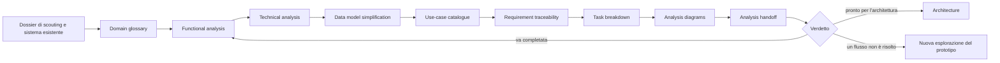

## 2. Position in the lifecycle

Caption: l'analisi dentro il ciclo di elicitazione e l'unica condizione che lo chiude.

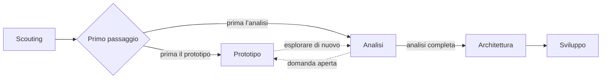

## 3. Requirements flows and surfaces

Caption: cosa fa l'applicazione, su quale superficie si osserva e cosa esclude.

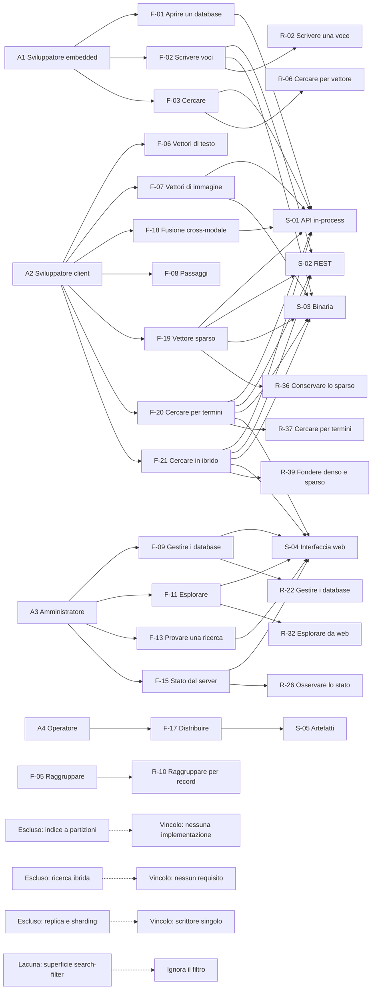

## 4. Components and data ownership

Caption: i componenti, la loro responsabilità unica, i dati posseduti e la direzione dei contratti. Nessuna tecnologia.

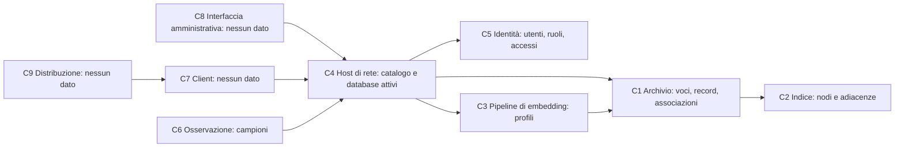

## 5. Data ownership partition across the boundaries

Caption: quale confine possiede quali dati e i punti in cui un confine ha bisogno di dati altrui.

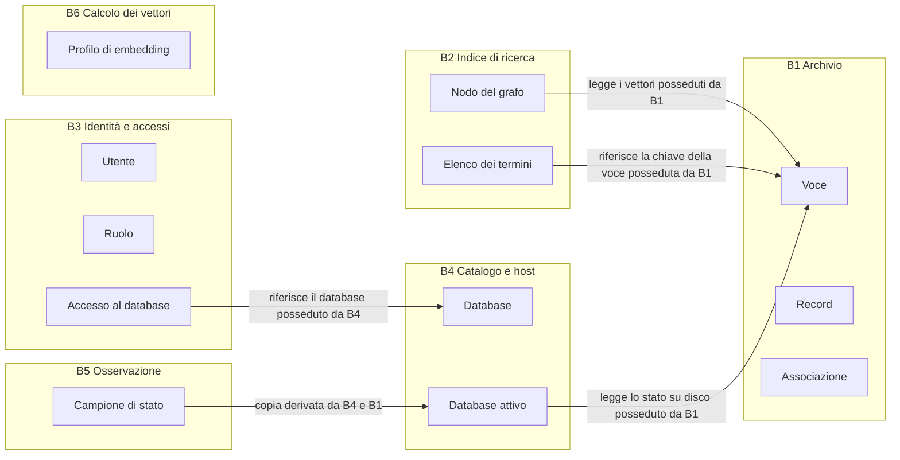

## 6. Canonical data model

Caption: una entità per concetto, un proprietario per dato, ogni struttura giustificata da un requisito.

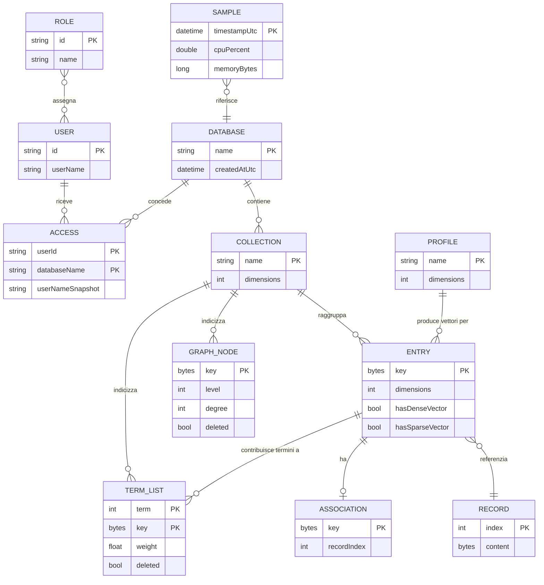

Caption: ogni struttura sopravvissuta è giustificata da un requisito.

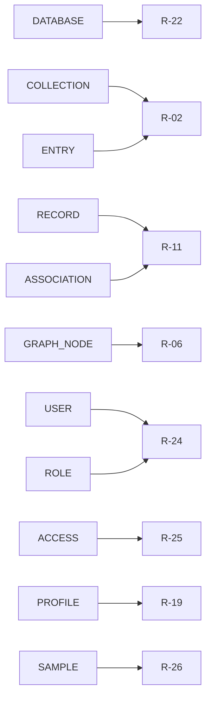

## 7. Use-case pairing and paths

Caption: le azioni accoppiate alle operazioni e alle superfici, con le azioni locali dichiarate. Un'azione assente da qui non viene costruita.

### UC-01 Aprire un database embedded

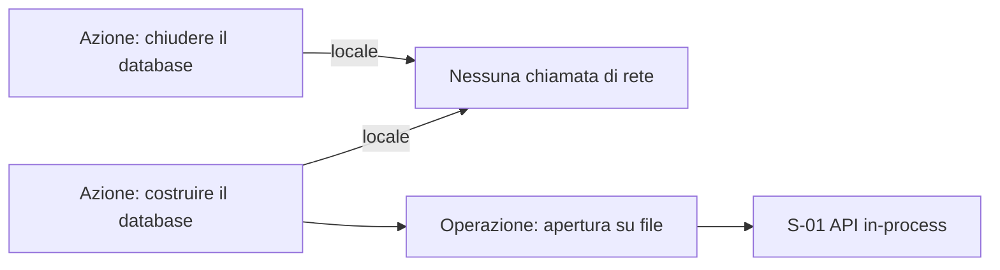

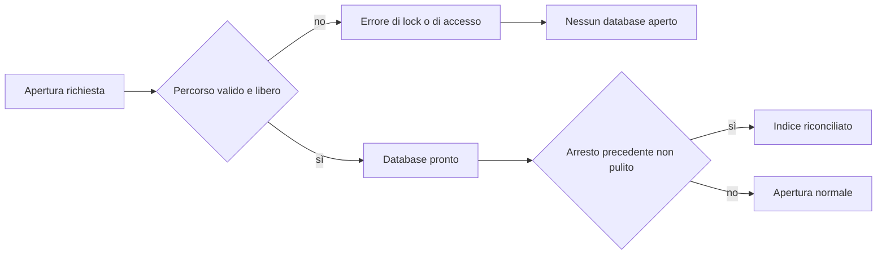

### UC-02 Scrivere o aggiornare voci

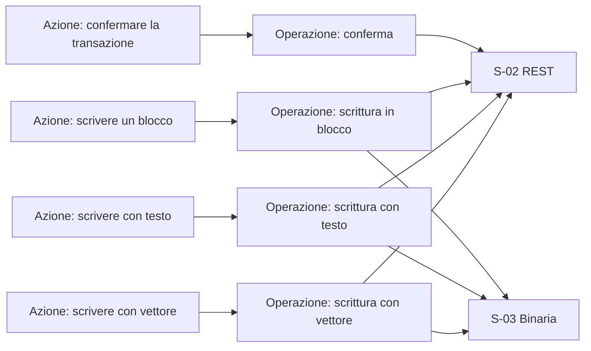

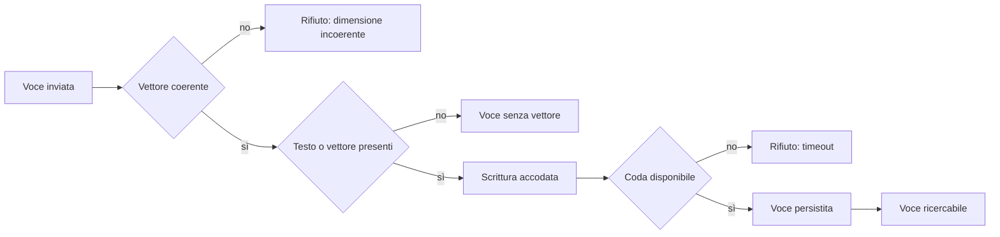

### UC-03 Cercare per similarità

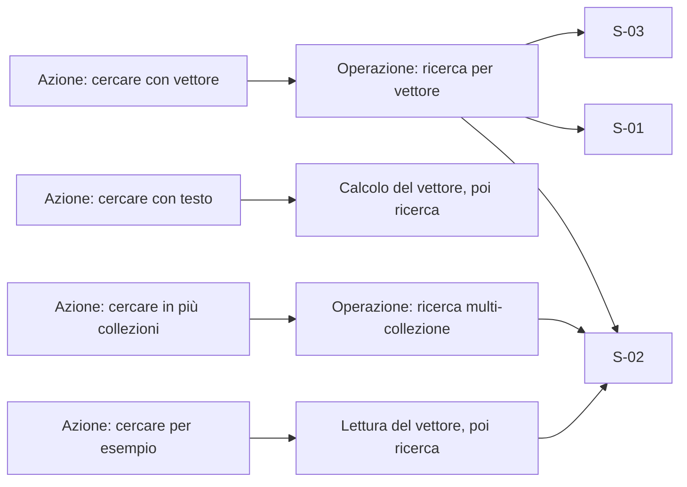

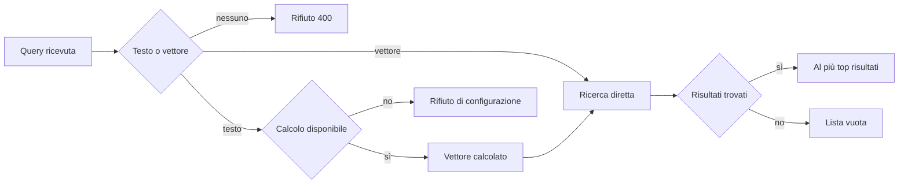

### UC-04 Cercare con filtro

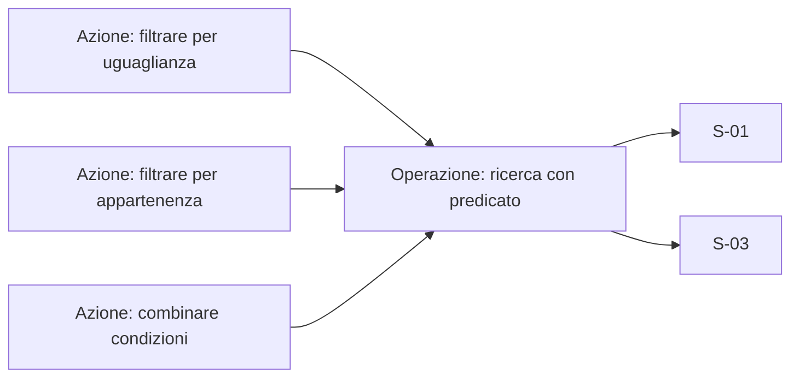

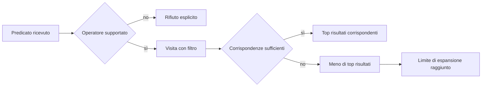

### UC-05 Raggruppare per record condiviso

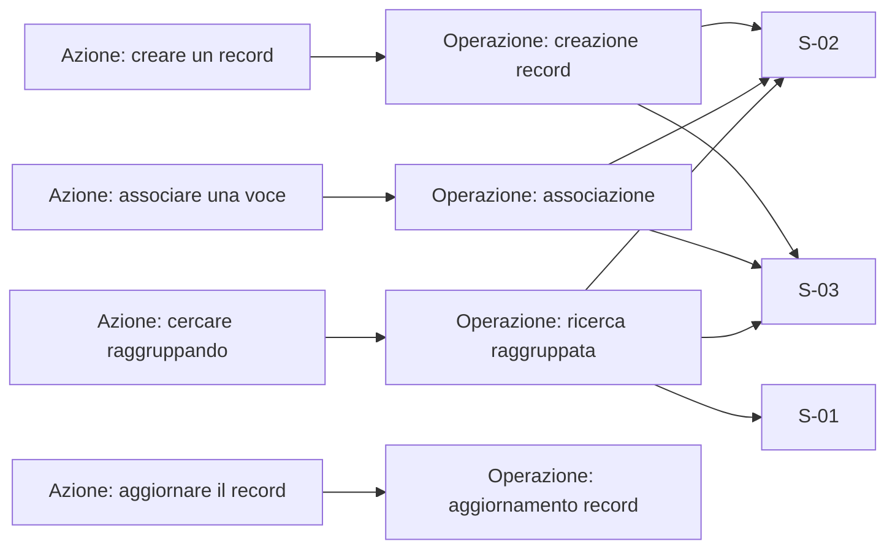

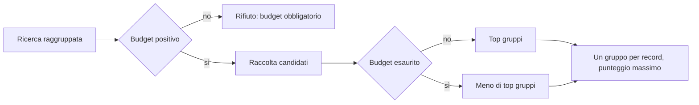

### UC-06 Generare vettori di testo

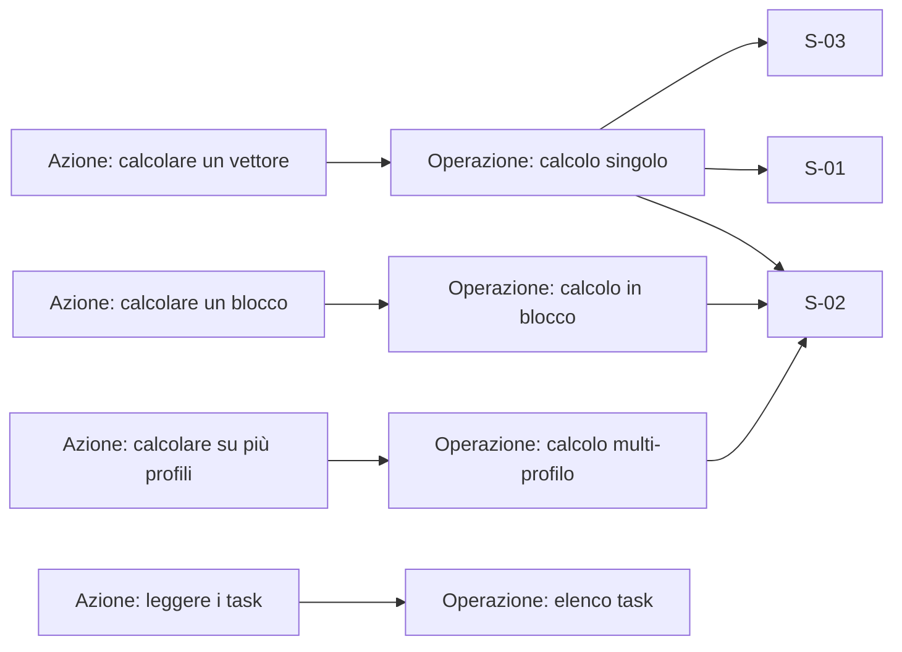

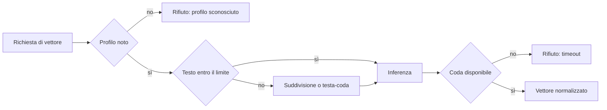

### UC-07 Generare vettori di immagine

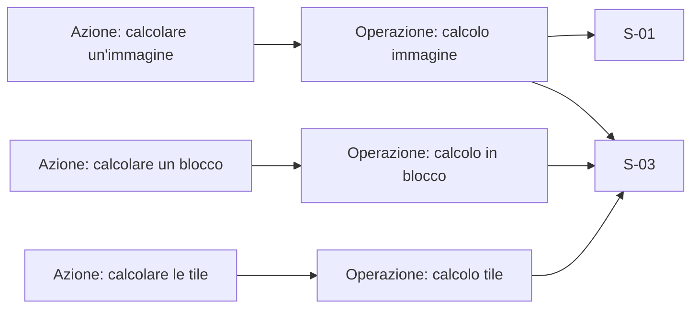

```mermaid
flowchart LR
  I0["Immagine ricevuta"] --> I1{"Modello configurato"}
  I1 -- "no" --> I2["Rifiuto di configurazione"]
  I1 -- "sì" --> I3{"Formato decodificabile"}
  I3 -- "no" --> I4["Rifiuto: formato non supportato"]
  I3 -- "sì" --> I5{"Modalità tile"}
  I5 -- "no" --> I6["Un vettore globale"]
  I5 -- "sì" --> I7["N tile più il vettore globale in coda"]
```

### UC-08 Dividere un testo in passaggi

```mermaid
flowchart LR
  U1["Azione: contare i passaggi"] --> O1["Operazione: conteggio"]
  U2["Azione: calcolare i passaggi"] --> O2["Operazione: calcolo passaggi"]
  O1 --> S2["S-02"]
  O1 --> S3["S-03"]
  O2 --> S2
  O2 --> S3
```

```mermaid
flowchart LR
  P0["Richiesta passaggi"] --> P1{"Parametri validi"}
  P1 -- "no" --> P2["Rifiuto 400 con il limite"]
  P1 -- "sì" --> P3["Suddivisione sovrapposta"]
  P3 --> P4["Un vettore per passaggio"]
  P4 --> P5["Conteggio coerente"]
```

### UC-09 Gestire i database del server

```mermaid
flowchart LR
  U1["Azione: aprire l'elenco"] --> O1["Operazione: elenco database"]
  U2["Azione: creare un database"] --> O2["Operazione: creazione"]
  U3["Azione: aprire il dettaglio"] --> O3["Operazione: dettagli"]
  U4["Azione: eliminare un database"] --> O4["Operazione: eliminazione con scelta file"]
  U5["Azione: ricaricare"] -- "locale, ripete l'elenco" --> O1
  O1 --> S4["S-04"]
  O1 --> S2["S-02"]
  O2 --> S4
  O2 --> S2
  O3 --> S4
  O3 --> S2
  O4 --> S4
  O4 --> S2
```

```mermaid
flowchart LR
  D0["Azione sul database"] --> D1{"Nome valido"}
  D1 -- "no" --> D2["Messaggio sul campo"]
  D1 -- "sì" --> D3{"Operazione consentita"}
  D3 -- "no" --> D4["404 senza rivelare l'esistenza"]
  D3 -- "sì" --> D5{"Eliminazione"}
  D5 -- "senza file" --> D6["Database rimosso, file conservati"]
  D5 -- "con file" --> D7["Database e file rimossi"]
  D5 -- "no" --> D8["Database creato o dettaglio mostrato"]
```

### UC-10 Assegnare utenti a un database

```mermaid
flowchart LR
  U1["Azione: aprire il pannello"] --> O1["Operazione: utenti del database e catalogo utenti"]
  U2["Azione: selezionare utenti"] -- "locale" --> L1["Nessuna chiamata"]
  U3["Azione: salvare"] --> O2["Operazione: sostituzione degli accessi"]
  O1 --> S4["S-04"]
  O1 --> S2["S-02"]
  O2 --> S4
  O2 --> S2
```

```mermaid
flowchart LR
  A0["Salvataggio richiesto"] --> A1{"Chiamante amministratore"}
  A1 -- "no" --> A2["403, nessuna modifica"]
  A1 -- "sì" --> A3{"Utenti validi"}
  A3 -- "no" --> A4["Rifiuto esplicito"]
  A3 -- "sì" --> A5{"Database esistente"}
  A5 -- "no" --> A6["404"]
  A5 -- "sì" --> A7["Accessi sostituiti e persistiti"]
```

### UC-11 Esplorare collezioni e voci

```mermaid
flowchart LR
  U1["Azione: scegliere il database"] --> O1["Operazione: elenco database"]
  U2["Azione: aprire una collezione"] --> O2["Operazione: informazioni di collezione"]
  U3["Azione: aprire una voce"] --> O3["Operazione: lettura per chiave"]
  U4["Azione: modificare il contenuto"] --> O4["Operazione: scrittura sulla stessa chiave"]
  U5["Azione: eliminare una voce"] --> O5["Operazione: eliminazione per chiave"]
  U6["Azione: aprire il workbench"] -- "locale, navigazione" --> L1["Nessuna chiamata"]
  O1 --> S4["S-04"]
  O2 --> S4
  O2 --> S2["S-02"]
  O3 --> S4
  O3 --> S2
  O4 --> S4
  O5 --> S4
```

```mermaid
flowchart LR
  E0["Collezione scelta"] --> E1{"Indice presente"}
  E1 -- "no" --> E2["Messaggio: nessuna metrica"]
  E1 -- "sì" --> E3["Tabella con metriche"]
  E3 --> E4{"Voce aperta"}
  E4 -- "chiave con tipo corretto" --> E5["Contenuto mostrato"]
  E4 -- "tipo sbagliato" --> E6["Voce non trovata"]
  E5 --> E7["Modifica o eliminazione"]
  E7 --> E8["Stato aggiornato al ricaricamento"]
```

### UC-12 Esplorare il grafo dell'indice

```mermaid
flowchart LR
  U1["Azione: scegliere collezione"] --> O1["Operazione: snapshot del grafo"]
  U2["Azione: evidenziare i corrispondenti"] --> O2["Operazione: ricerca con filtro"]
  U3["Azione: azzerare l'evidenziazione"] -- "locale" --> L1["Nessuna chiamata"]
  U4["Azione: ricaricare"] -- "locale, ripete lo snapshot" --> O1
  O1 --> S4["S-04"]
  O1 --> S2["S-02"]
  O2 --> S4
```

```mermaid
flowchart LR
  G0["Collezione scelta"] --> G1{"Indice presente"}
  G1 -- "no" --> G2["Snapshot vuoto con messaggio"]
  G1 -- "sì" --> G3["Nodi e adiacenze disegnati"]
  G3 --> G4{"Ricerca di evidenziazione"}
  G4 -- "risultati" --> G5["Nodi evidenziati"]
  G4 -- "nessun risultato" --> G6["Nessuna evidenziazione"]
```

### UC-13 Provare una ricerca

```mermaid
flowchart LR
  U1["Azione: scegliere collezione"] --> O1["Operazione: elenco e informazioni"]
  U2["Azione: scegliere la modalità"] -- "locale" --> L1["Nessuna chiamata"]
  U3["Azione: impostare il numero"] -- "locale" --> L1
  U4["Azione: cercare su una collezione"] --> O2["Operazione: ricerca su collezione"]
  U5["Azione: cercare su più collezioni"] --> O3["Operazione: ricerca multi-collezione"]
  O1 --> S4["S-04"]
  O2 --> S4
  O3 --> S4
  O2 --> S2["S-02"]
  O3 --> S2
```

```mermaid
flowchart LR
  W0["Ricerca inviata"] --> W1{"Testo valido o vettore numerico"}
  W1 -- "no" --> W2["Messaggio sul campo"]
  W1 -- "sì" --> W3{"Calcolo disponibile"}
  W3 -- "no" --> W4["Errore di configurazione"]
  W3 -- "sì" --> W5["Ricerca eseguita"]
  W5 --> W6{"Risultati"}
  W6 -- "sì" --> W7["Risultati con punteggio e tempi"]
  W6 -- "no" --> W8["Stato vuoto"]
```

### UC-14 Amministrare utenti e ruoli

```mermaid
flowchart LR
  U1["Azione: aprire la scheda utenti"] --> O1["Operazione: elenco utenti"]
  U2["Azione: creare, modificare, eliminare utente"] --> O2["Operazioni su utente"]
  U3["Azione: aprire la scheda ruoli"] --> O3["Operazione: elenco ruoli"]
  U4["Azione: creare, modificare, eliminare ruolo"] --> O4["Operazioni su ruolo"]
  U5["Azione: leggere gli utenti di un ruolo"] --> O5["Operazione: utenti per ruolo"]
  O1 --> S4["S-04"]
  O2 --> S4
  O2 --> S2["S-02"]
  O3 --> S4
  O4 --> S4
  O5 --> S2
```

```mermaid
flowchart LR
  S0["Operazione su identità"] --> S1{"Chiamante amministratore"}
  S1 -- "no" --> S2["403"]
  S1 -- "sì" --> S3{"Nome già esistente"}
  S3 -- "sì" --> S4["Conflitto mostrato"]
  S3 -- "no" --> S5["Entità persistita"]
  S5 --> S6{"Eliminazione dell'utente corrente"}
  S6 -- "sì" --> S7["Sessione invalidata"]
  S6 -- "no" --> S8["Elenco aggiornato"]
```

### UC-15 Osservare lo stato del server

```mermaid
flowchart LR
  U1["Azione: aprire la panoramica"] --> O1["Operazione: campioni della finestra"]
  U2["Azione: cambiare finestra"] --> O1
  U3["Azione: ricaricare"] -- "locale, ripete la lettura" --> O1
  O1 --> S4["S-04"]
  O1 --> S2["S-02"]
```

```mermaid
flowchart LR
  M0["Lettura richiesta"] --> M1{"Storico disponibile"}
  M1 -- "no" --> M2["Meno campioni, nessun errore"]
  M1 -- "sì" --> M3["Campioni della finestra"]
  M3 --> M4{"Database accessibili"}
  M4 -- "alcuni" --> M5["Solo i database dell'utente"]
  M4 -- "tutti" --> M6["Tutti i database"]
  M5 --> M7["Indicatori e grafici"]
  M6 --> M7
```

### UC-16 Eseguire una transazione

```mermaid
flowchart LR
  U1["Azione: aprire"] --> O1["Operazione: apertura"]
  U2["Azione: aggiungere o eliminare"] --> O2["Operazioni accodate"]
  U3["Azione: confermare"] --> O3["Operazione: conferma"]
  U4["Azione: annullare"] --> O4["Operazione: annullamento"]
  O1 --> S1["S-01"]
  O1 --> S2["S-02"]
  O1 --> S3["S-03"]
  O2 --> S2
  O3 --> S2
  O4 --> S2
```

```mermaid
flowchart LR
  T0["Transazione aperta"] --> T1{"Operazione consentita"}
  T1 -- "annidata o cancellazione collezione" --> T2["Rifiuto"]
  T1 -- "sì" --> T3["Operazione accodata"]
  T3 --> T4{"Esito"}
  T4 -- "conferma" --> T5["Blocco unico durevole"]
  T4 -- "annullamento" --> T6["Buffer scartato"]
  T4 -- "arresto o abbandono" --> T7["Registro troncato al riavvio"]
```

### UC-17 Distribuire e aggiornare

```mermaid
flowchart LR
  U1["Azione: installare il pacchetto"] -- "locale" --> L1["Nessuna chiamata di rete"]
  U2["Azione: avviare il server"] -- "locale" --> L1
  U3["Azione: avviare i lavoratori"] -- "locale" --> L1
  U4["Azione: aggiornare la versione"] -- "locale" --> L1
  U2 --> S5["S-05 Artefatti"]
  U3 --> S5
```

```mermaid
flowchart LR
  R0["Avvio"] --> R1{"Porte libere"}
  R1 -- "no" --> R2["Avvio fallito"]
  R1 -- "sì" --> R3{"Volume dati presente"}
  R3 -- "sì" --> R4["Database riaperti e indice ricostruito"]
  R3 -- "no" --> R5["Server vuoto"]
  R4 --> R6{"Modelli presenti"}
  R6 -- "no" --> R7["Ricerca per testo rifiutata"]
  R6 -- "sì" --> R8["Server operativo"]
```

### UC-18 Combinare risultati di più modalità

```mermaid
flowchart LR
  U1["Azione: cercare in ogni modalità"] --> O1["Operazioni di ricerca, una per collezione"]
  U2["Azione: fondere i risultati"] -- "locale" --> L1["Nessuna chiamata di rete"]
  O1 --> S2["S-02"]
  O1 --> S3["S-03"]
  U2 --> O2["Calibrazione per gruppo e ordinamento unico"]
```

```mermaid
flowchart LR
  C0["Gruppi di risultati"] --> C1{"Gruppo con varianza"}
  C1 -- "no" --> C2["Punteggio calibrato neutro"]
  C1 -- "sì" --> C3["Punteggio calibrato per gruppo"]
  C2 --> C4["Ordinamento unico"]
  C3 --> C4
  C4 --> C5["Risultato con modalità di provenienza e punteggio grezzo"]
```

### UC-19 Scrivere e rileggere una voce con vettore sparso

```mermaid
flowchart LR
  U1["Azione: scrivere con solo denso"] --> O1["Operazione: scrittura con vettore denso"]
  U2["Azione: scrivere con solo sparso"] --> O2["Operazione: scrittura con termini e pesi"]
  U3["Azione: scrivere con entrambi"] --> O3["Operazione di scrittura con due slot"]
  U4["Azione: rileggere la voce"] --> O4["Operazione: lettura per chiave"]
  O1 --> S1["S-01"]
  O2 --> S2["S-02"]
  O2 --> S3["S-03"]
  O3 --> S2
  O4 --> S1
```

```mermaid
flowchart LR
  W0["Voce con pesi inviata"] --> W1{"Termini unici e crescenti"}
  W1 -- "no" --> W2["Rifiuto 400 con il termine in errore"]
  W1 -- "sì" --> W3{"Almeno un peso diverso da zero"}
  W3 -- "no" --> W4["Rifiuto 400"]
  W3 -- "sì" --> W5{"Entro il massimo di termini"}
  W5 -- "no" --> W6["Rifiuto 400 con il limite"]
  W5 -- "sì" --> W7["Voce accodata e termini indicizzati"]
  W7 --> W8["Rilettura con le stesse coppie"]
```

### UC-20 Cercare per vettore sparso

```mermaid
flowchart LR
  U1["Azione: cercare per termini"] --> O1["Operazione: ricerca sparsa con top-k"]
  U2["Azione: cercare con filtro"] --> O2["Operazione: ricerca sparsa con predicato"]
  U3["Azione: raggruppare per record condiviso"] --> O3["Operazione: ricerca sparsa raggruppata"]
  U4["Azione: eseguire dal workbench"] --> O4["Operazione: ricerca sparsa"]
  O1 --> S1["S-01"]
  O1 --> S2["S-02"]
  O4 --> S4["S-04"]
```

```mermaid
flowchart LR
  Q0["Query con termini"] --> Q1{"Almeno un termine valido"}
  Q1 -- "no" --> Q2["Rifiuto 400"]
  Q1 -- "sì" --> Q3{"Filtro presente"}
  Q3 -- "sì" --> Q4["Visita completa degli elenchi, poi filtro"]
  Q3 -- "no" --> Q5{"Potatura attiva"}
  Q5 -- "sì" --> Q6["Salto degli elenchi sotto il limite superiore"]
  Q5 -- "no" --> Q7["Visita completa degli elenchi"]
  Q4 --> Q8["Top k per punteggio"]
  Q6 --> Q8
  Q7 --> Q8
  Q8 --> Q9{"Raggruppamento richiesto"}
  Q9 -- "sì" --> Q10["Un gruppo per record, con il punteggio massimo"]
  Q9 -- "no" --> Q11["Voci ordinate"]
```

### UC-21 Cercare in ibrido e fondere

```mermaid
flowchart LR
  U1["Azione: cercare con entrambi i vettori"] --> O1["Ricerca densa e ricerca sparsa"]
  U2["Azione: dichiarare i pesi"] --> O2["Fusione in un ordinamento unico"]
  U3["Azione: usare una sola modalità"] --> O3["Peso a zero sull'altra"]
  O1 --> S2["S-02"]
  O2 --> S3["S-03"]
  O3 --> S1["S-01"]
```

```mermaid
flowchart LR
  H0["Richiesta ibrida"] --> H1{"Almeno un vettore fornito"}
  H1 -- "no" --> H2["Rifiuto 400"]
  H1 -- "sì" --> H3{"Pesi dichiarati"}
  H3 -- "no" --> H4["Rifiuto 400"]
  H3 -- "sì" --> H5{"Entrambi i pesi a zero"}
  H5 -- "sì" --> H6["Rifiuto 400"]
  H5 -- "no" --> H7{"Un peso a zero"}
  H7 -- "sì" --> H8["Una sola modalità"]
  H7 -- "no" --> H9["Due elenchi e fusione per posizione"]
  H8 --> H10["Ordinamento unico"]
  H9 --> H10
  H10 --> H11["Parità risolta in modo deterministico"]
```

## 8. Requirement to task traceability

Caption: i requisiti che raggiungono i pacchetti e i due casi di fallimento.

```mermaid
flowchart LR
  R01["R-01 Aprire un database"] --> T02["T-02 Archivio e durabilità"]
  R02["R-02 Scrivere una voce"] --> T03["T-03 Operazioni sulle voci"]
  R06["R-06 Cercare per vettore"] --> T04["T-04 Ricerca"]
  R07["R-07 Cercare per testo"] --> T06["T-06 Testo e ricerca"]
  R10["R-10 Raggruppare"] --> T07["T-07 Record condivisi"]
  R16["R-16 Vettori di testo"] --> T05["T-05 Calcolo dei vettori"]
  R21["R-21 Esporre il server"] --> T08["T-08 Server"]
  R23["R-23 Autenticare"] --> T09["T-09 Accesso"]
  R26["R-26 Stato del server"] --> T10["T-10 Osservazione"]
  R28["R-28 Delegare il calcolo"] --> T11["T-11 Delega"]
  R29["R-29 Client tipizzati"] --> T12["T-12 Client e provider"]
  R35["R-35 Fusione cross-modale"] --> T12
  R36["R-36 Conservare il vettore sparso"] --> T16["T-16 Vettori sparsi"]
  R41["R-41 Osservare l'indice dei termini"] --> T16
  R37["R-37 Cercare per termini"] --> T17["T-17 Ricerca sparsa"]
  R38["R-38 Filtro e raggruppamento"] --> T17
  R39["R-39 Fondere denso e sparso"] --> T17
  R40["R-40 Parità fra superfici"] --> T18["T-18 Parità"]
  R31["R-31 Distribuire"] --> T13["T-13 Artefatti"]
  R32["R-32 Esplorare da web"] --> T14["T-14 Interfaccia"]
  R34["R-34 Documentare"] --> T15["T-15 Documentazione"]
  R11["R-11 Record condivisi"] --> T07
  R08["R-08 Filtrare"] --> T04
  R09["R-09 Regolare la ricerca"] --> T04
  R12["R-12 Durabilità"] --> T02
  R13["R-13 Recupero"] --> T02
  R14["R-14 Transazione"] --> T02
  R15["R-15 Compattazione"] --> T02
  R17["R-17 Testi lunghi"] --> T05
  R18["R-18 Immagini"] --> T05
  R19["R-19 Più profili"] --> T05
  R20["R-20 Passaggi"] --> T05
  R22["R-22 Ciclo di vita"] --> T08
  R24["R-24 Utenti e ruoli"] --> T09
  R25["R-25 Accessi al database"] --> T09
  R27["R-27 Ingestione in blocco"] --> T08
  R30["R-30 Astrazione di provider"] --> T12
  R33["R-33 Prova di ricerca"] --> T14
  R03["R-03 Aggiornare"] --> T03
  R04["R-04 Eliminare"] --> T03
  R05["R-05 Elencare e contare"] --> T03
  T01["T-01 Modello canonico"] --> R02
```

Nessun requisito senza pacchetto. Nessun pacchetto senza requisito. Nessun rinvio.

## 9. Task dependency graph

Caption: le dipendenze fra i pacchetti, acicliche, e le catene che possono partire subito.

```mermaid
flowchart LR
  T01["T-01 Modello canonico"] --> T02["T-02 Archivio e durabilità"]
  T01 --> T03["T-03 Operazioni sulle voci"]
  T02 --> T03
  T03 --> T04["T-04 Ricerca"]
  T03 --> T16["T-16 Vettori sparsi"]
  T16 --> T17["T-17 Ricerca sparsa"]
  T04 --> T17
  T17 --> T18["T-18 Parità"]
  T12 --> T18
  T14 --> T18
  T05["T-05 Calcolo dei vettori"] --> T06["T-06 Testo e ricerca"]
  T04 --> T06
  T03 --> T07["T-07 Record condivisi"]
  T03 --> T08["T-08 Server"]
  T04 --> T08
  T07 --> T08
  T08 --> T09["T-09 Accesso"]
  T08 --> T10["T-10 Osservazione"]
  T05 --> T11["T-11 Delega"]
  T08 --> T11
  T08 --> T12["T-12 Client e provider"]
  T08 --> T13["T-13 Artefatti"]
  T11 --> T13
  T08 --> T14["T-14 Interfaccia"]
  T09 --> T14
  T10 --> T14
  T08 --> T15["T-15 Documentazione"]
  T09 --> T15
  T10 --> T15
  T12 --> T15
  T13 --> T15
  T14 --> T15
```

Catene che partono subito: T-01 e T-05. La catena dei vettori sparsi parte da T-01 e si innesta su T-03.

## 10. Data sources, actors and output types

Caption: le fonti usate dall'analisi, gli attori che le producono o le leggono e i tipi di output.

```mermaid
flowchart LR
  DOC["Documentazione in docs/"]
  CODE["Codice, interfaccia e test"]
  SCT["Dossier di scouting"]
  HUM["Attore umano: maintainer e amministratore"]
  AGT["Attore LLM: agente di analisi"]
  SYS["Attore di sistema: test e build"]
  DOS["Output: dossier di analisi"]
  DIA["Output: set di diagrammi"]
  SUM["Output: sintesi di fase"]
  UX["Output: riferimento all'esperienza"]
  UC["Output: catalogo dei casi d'uso"]
  DOC -->|"Comportamento documentato"| AGT
  CODE -->|"Comportamento realizzato e lacune"| AGT
  SCT -->|"Vincoli e domande aperte"| AGT
  HUM -->|"Obiettivi e preferenze"| AGT
  SYS -->|"Esiti misurati"| AGT
  AGT -->|"Requisiti e modello"| DOS
  AGT -->|"Flussi e requisiti"| DIA
  AGT -->|"Sintesi"| SUM
  AGT -->|"Superfici e stati"| UX
  AGT -->|"Accoppiamenti e percorsi"| UC
  UC -->|"Contratto per lo sviluppo"| HUM
```

## 11. Management services per step

Caption: il flusso logico dell'analisi con le responsabilità di gestione, i dati scambiati e il percorso delle lacune.

```mermaid
flowchart LR
  IN["Documentazione, codice e scouting"] -->|"Materiale da leggere"| G["Fissare il vocabolario"]
  G -->|"Termini e definizioni"| F["Formulare i requisiti"]
  F -->|"Requisiti e flussi"| T["Descrivere la forma tecnica"]
  T -->|"Componenti e proprietà"| M["Ridurre al modello canonico"]
  M -->|"Modello canonico"| U["Accoppiare azioni e percorsi"]
  U -->|"Casi d'uso"| TR["Verificare la tracciabilità"]
  TR -->|"Matrice"| TB["Scomporre in pacchetti"]
  TB -->|"Pacchetti e dipendenze"| D["Disegnare il set"]
  D -->|"Diagrammi"| H["Verdetto e passaggio"]
  H -->|"Esito"| OUT["Dossier, diagrammi, sintesi"]
  U -->|"Azione senza accoppiamento"| GAP["Lacune dichiarate"]
  T -->|"Confine con due proprietari"| GAP
  F -->|"Requisito senza criterio"| GAP
  GAP -->|"Correzione"| F
```

## 12. Service data flows grouped by deployment

Caption: le unità di deployment documentate e i flussi fra esse. Rappresenta la documentazione corrente, non una decisione dell'analisi.

```mermaid
flowchart LR
  CLIENT["Client .NET o Python"]
  subgraph APP["Processo dell'applicazione .NET"]
    STORE["Archivio embedded"]
    IDX["Indice di ricerca"]
    EMBC["Calcolo dei vettori locale"]
    STORE -->|"Voci da indicizzare"| IDX
    EMBC -->|"Vettori calcolati"| STORE
  end
  subgraph AIO["Container completo"]
    S1["Superfici di rete"]
    DB1["Archivio"]
    EM1["Calcolo dei vettori incluso"]
    S1 -->|"Operazioni"| DB1
    S1 -->|"Richieste di vettori"| EM1
    EM1 -->|"Vettori"| DB1
  end
  subgraph SRV["Container del server"]
    S2["Superfici di rete"]
    DB2["Archivio"]
    S2 -->|"Operazioni"| DB2
  end
  subgraph WRK["Container dei lavoratori"]
    W1["Calcolo dei vettori"]
  end
  subgraph MQ["Broker"]
    B1["Coda delle richieste"]
  end
  CLIENT -->|"Operazioni tipizzate"| S1
  CLIENT -->|"Operazioni tipizzate"| S2
  S2 -->|"Richieste di vettori"| B1
  B1 -->|"Richieste di vettori"| W1
  W1 -->|"Vettori calcolati"| B1
  B1 -->|"Vettori calcolati"| S2
```

## Gaps

- Il modello canonico non ha una superficie utente per i record condivisi: i requisiti R-10 e R-11 sono coperti solo dalle superfici di programmazione.
- La superficie `search-filter` accetta un filtro e lo ignora. Nessun caso d'uso la copre.
- L'interfaccia web chiama tre rotte di menu che il server non espone.
- La pagina impostazioni non ha funzioni e nessun requisito la copre.
- Non esiste una direzione validata da un prototipo: il riferimento all'esperienza registra la direzione corrente come punto di partenza.
- Il contrasto dei colori non è misurato. I diagrammi non usano palette personalizzate.
- La ricerca sparsa con potatura può perdere risultati ammessi: l'esattezza è garantita solo senza potatura o con un filtro attivo.
- La memoria dell'indice dei termini non è misurata: il limite dichiarabile è un'incognita aperta.
