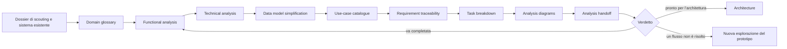

# Analysis dossier

## Analysis diagrams

Preferenza di lettura registrata: diagram-first. Questo dossier apre con la mappa della fase; il set completo sta in [Analysis diagrams](diagrams.md) (diagrams.md).

Indice:

1. [Phase flow](diagrams.md#1-phase-flow) (diagrams.md#1-phase-flow)
2. [Position in the lifecycle](diagrams.md#2-position-in-the-lifecycle) (diagrams.md#2-position-in-the-lifecycle)
3. [Requirements flows and surfaces](diagrams.md#3-requirements-flows-and-surfaces) (diagrams.md#3-requirements-flows-and-surfaces)
4. [Components and data ownership](diagrams.md#4-components-and-data-ownership) (diagrams.md#4-components-and-data-ownership)
5. [Data ownership partition](diagrams.md#5-data-ownership-partition-across-the-boundaries) (diagrams.md#5-data-ownership-partition-across-the-boundaries)
6. [Canonical data model](diagrams.md#6-canonical-data-model) (diagrams.md#6-canonical-data-model)
7. [Use-case pairing and paths](diagrams.md#7-use-case-pairing-and-paths) (diagrams.md#7-use-case-pairing-and-paths)
8. [Requirement to task traceability](diagrams.md#8-requirement-to-task-traceability) (diagrams.md#8-requirement-to-task-traceability)
9. [Task dependency graph](diagrams.md#9-task-dependency-graph) (diagrams.md#9-task-dependency-graph)
10. [Data sources, actors and output types](diagrams.md#10-data-sources-actors-and-output-types) (diagrams.md#10-data-sources-actors-and-output-types)
11. [Management services per step](diagrams.md#11-management-services-per-step) (diagrams.md#11-management-services-per-step)
12. [Service data flows grouped by deployment](diagrams.md#12-service-data-flows-grouped-by-deployment) (diagrams.md#12-service-data-flows-grouped-by-deployment)

Diagrammi non applicabili: nessuno.

Lacune del set: vedi [Analysis diagrams](diagrams.md) (diagrams.md), sezione Gaps.

## Domain glossary

| Termine | Definizione | Sinonimi da evitare |
| --- | --- | --- |
| Database | Insieme di file sotto un nome, aperto da un solo processo alla volta. | istanza, schema |
| Catalogo dei database | Elenco dei database noti al server, con data di creazione e utenti associati. | registro, indice dei database |
| Collezione | Nome condiviso da un gruppo di voci dentro un database. Non si dichiara: esiste quando la prima voce viene scritta. | tabella, indice |
| Voce | Unità scritta sotto una chiave: un contenuto e, facoltativamente, un vettore. | documento, record, riga |
| Chiave | Identificatore binario di una voce, di lunghezza dipendente dal tipo usato alla scrittura. | id, pk |
| Contenuto | Payload serializzato di una voce. | body, payload |
| Vettore | Sequenza di numeri reali associata a una voce o a una query. | embedding, feature |
| Embedding | Operazione che produce un vettore da un testo o da un'immagine. | vettorizzazione, encoding |
| Spazio vettoriale | Insieme di vettori prodotti dallo stesso profilo di embedding, confrontabili fra loro. | modello, dominio |
| Profilo di embedding | Configurazione che lega un nome a un modello, a un tokenizzatore e a opzioni di generazione. | modello, pipeline |
| Record condiviso | Contenuto indirizzato da un indice opaco e leggibile da più voci. | metadato, documento condiviso |
| Associazione | Legame fra una voce e un record condiviso. | riferimento, link |
| Indice | Struttura che risponde alle ricerche su una collezione. | motore, engine |
| Grafo | Struttura di navigazione dell'indice approssimato, su più livelli. | HNSW, grafo HNSW |
| Ricerca esatta | Confronto del vettore di query con tutte le voci della collezione. | brute force, scansione |
| Ricerca approssimata | Visita parziale del grafo che restituisce i vicini più probabili. | ANN, ricerca vettoriale |
| Ricerca raggruppata | Ricerca che restituisce un risultato per record condiviso invece di uno per voce. | grouped search, dedup search |
| Budget di candidati | Limite al numero complessivo di candidati che una ricerca raggruppata può chiedere. | budget, limite |
| Richiamo | Frazione dei vicini veri restituiti dalla ricerca approssimata, misurata contro la ricerca esatta. | recall, accuratezza |
| Passaggio | Porzione di un testo, con sovrapposizione rispetto alla successiva, dotata di vettore proprio. | chunk, frammento |
| Transazione | Gruppo di scritture con esito atomico rispetto alla durabilità. | batch, unit of work |
| Checkpoint | Punto in cui la coda di scrittura è svuotata e i dati sono resi durevoli. | flush, save |
| Scrittura accettata | La scrittura è in coda e la chiamata è tornata. | — |
| Scrittura persistita | La scrittura è visibile in lettura e in ricerca, ma non ancora resa durevole. | — |
| Scrittura durevole | La scrittura è stata resa durevole da un checkpoint. | — |
| Compattazione | Riscrittura dei file che recupera lo spazio delle versioni superate. | shrink, vacuum |
| Server | Processo che apre più database e li espone in rete. | host, istanza |
| Utente | Identità autenticata. | account, principal |
| Ruolo | Insieme di permessi assegnabile a un utente. | gruppo |
| Accesso al database | Diritto di un utente di leggere un database del catalogo. | ownership, permesso database |
| Campione di stato | Misura periodica di CPU, memoria, code e dimensioni. | metrica, sample |
| Superficie | Insieme di operazioni offerte a un attore su un canale. | endpoint, interfaccia |

**Termini con significati diversi fra attori.**

- «Documento»: per lo sviluppatore è una voce con contenuto; per l'amministratore è una voce visibile in interfaccia. Significato scelto: voce.
- «Indice»: per lo sviluppatore è la struttura di ricerca; per l'amministratore è la voce di menu della collezione. Significato scelto: struttura di ricerca.

**Termini ancora non definiti.** Nessuno. La voce «prototipo» non esiste per questo sistema: l'interfaccia amministrativa è in produzione e non deriva da un prototipo.

## Functional analysis

**Stato dell'input.** Secondo giro di analisi, condotto sul codice al commit `b706e06`. Il primo giro ha chiuso con l'analisi completa; questo giro verifica ogni affermazione contro il repository e corregge dove il codice dice altro. Il prototipo non è stato eseguito e non esiste una sua esplorazione: i flussi derivano dai requisiti e dal comportamento del sistema esistente. La riconciliazione con un prototipo avverrà se e quando ne verrà esplorato uno.

**Correzioni di questo giro.**

| Correzione | Prima | Ora | Motivo |
| --- | --- | --- | --- |
| Superfici della generazione di vettori di immagine | S-02, S-03 | S-01, S-03 | La superficie REST non espone alcuna rotta per le immagini; il calcolo esiste in-process e nella superficie binaria. |
| Flusso di combinazione cross-modale | Assente | F-18, R-35 | Il client .NET offre la fusione calibrata dei risultati di più modalità e nessun requisito la copriva. |
| Voci multiple per documento | Non dichiarato | Dichiarato nel modello dati | Un documento con più vettori è N voci più un record condiviso: nessuna entità nuova. |

**Attori e obiettivo unico.**

| Id | Attore | Obiettivo |
| --- | --- | --- |
| A1 | Sviluppatore embedded | Usare il database dentro il proprio processo, senza servizi aggiuntivi. |
| A2 | Sviluppatore client | Usare il database da un altro processo o da un altro linguaggio. |
| A3 | Amministratore della piattaforma | Gestire database, accessi e stato del server. |
| A4 | Operatore di deployment | Installare e aggiornare il prodotto. |
| A5 | Applicazione chiamante | Ottenere ricerche e scritture con latenza e richiamo dichiarati. |
| A6 | Lavoratore di embedding | Calcolare vettori per conto del server. |

**Flussi numerati.** Ogni flusso dichiara la superficie su cui si osserva e il punto di ingresso.

| Id | Flusso | Superficie | Punto di ingresso | Esito |
| --- | --- | --- | --- | --- |
| F-01 | Aprire un database embedded | S-01 API in-process | Costruzione del database sul percorso dati | Successo, errore di lock |
| F-02 | Scrivere o aggiornare voci | S-01, S-02 API REST, S-03 API binaria | Scrittura di una voce o di un blocco | Accettata, rifiutata |
| F-03 | Cercare per similarità | S-01, S-02, S-03 | Ricerca per vettore o per testo | Successo, risultato vuoto |
| F-04 | Cercare con filtro | S-01, S-03 | Predicato su proprietà della voce | Successo, risultato parziale |
| F-05 | Raggruppare per record condiviso | S-01, S-02, S-03 | Ricerca raggruppata con budget | Successo, gruppi insufficienti |
| F-06 | Generare vettori di testo | S-01, S-02, S-03 | Richiesta di embedding | Successo, rifiuto per coda piena |
| F-07 | Generare vettori di immagine | S-01, S-03 | Richiesta di embedding immagine o tile | Successo, modello non configurato |
| F-08 | Dividere un testo in passaggi | S-02, S-03 | Richiesta di passaggi o conteggio | Successo, parametri fuori intervallo |
| F-09 | Gestire i database del server | S-04 interfaccia web, S-02 | Elenco database, creazione, eliminazione | Successo, non trovato, vietato |
| F-10 | Assegnare utenti a un database | S-04, S-02 | Dettaglio database, elenco utenti | Successo, vietato |
| F-11 | Esplorare collezioni e voci | S-04, S-02 | Elenco collezioni, dettaglio voce | Successo, non trovato |
| F-12 | Esplorare il grafo dell'indice | S-04, S-02 | Snapshot del grafo di una collezione | Successo, indice assente |
| F-13 | Provare una ricerca | S-04 | Workbench | Successo, risultato vuoto, errore |
| F-14 | Amministrare utenti e ruoli | S-04, S-02 | Elenco utenti, elenco ruoli | Successo, conflitto, vietato |
| F-15 | Osservare lo stato del server | S-04, S-02 | Finestra 1m, 5m, 10m, 1h | Successo, storico insufficiente |
| F-16 | Eseguire una transazione | S-01, S-02, S-03 | Apertura, operazioni, conferma | Confermata, annullata, scaduta |
| F-17 | Distribuire e aggiornare | S-05 artefatti di distribuzione | Installazione e avvio | Successo, avvio negato |
| F-18 | Combinare risultati di più modalità | S-01 client .NET | Fusione dei risultati di più ricerche | Successo, gruppi non comparabili |

**Azioni di interfaccia per flusso.** L'elenco completo, con l'effetto atteso, è in [Use-case catalogue](#use-case-catalogue) (dossier.md#use-case-catalogue) e in [Use-case catalogue](../use-cases.md) (use-cases.md). Qui restano le azioni che il flusso dichiara.

- F-09: aprire l'elenco, creare un database, aprire il dettaglio, eliminare con o senza file.
- F-10: aprire il pannello utenti, selezionare utenti, salvare.
- F-11: scegliere il database, aprire una collezione, aprire una voce, modificare il contenuto, eliminare la voce.
- F-12: scegliere database e collezione, caricare lo snapshot, evidenziare i nodi corrispondenti.
- F-13: scegliere database, collezione, modalità di query, numero di risultati, eseguire.
- F-14: cambiare scheda utenti o ruoli, creare, modificare, eliminare.
- F-15: scegliere la finestra temporale.

**Stati finali per flusso.** Successo, rifiuto (`400`), non autenticato (`401`), vietato (`403`), non trovato (`404`), conflitto (`409`), errore (`5xx`), interruzione (abbandono o navigazione altrove). Il dettaglio per percorso è nel catalogo.

**Regole di validazione.** Solo quelle che il flusso richiede espressamente o che proteggono un invariante dichiarato.

| Id | Regola | Momento | Flusso |
| --- | --- | --- | --- |
| V-01 | Il nome di un database accetta lettere, cifre, punto, trattino e trattino basso, da 1 a 64 caratteri. | Creazione | F-09 |
| V-02 | Un database non può essere aperto due volte sullo stesso percorso. | Apertura | F-01 |
| V-03 | La chiave di lettura deve essere interpretata con il tipo usato alla scrittura. | Lettura e cancellazione | F-11 |
| V-04 | Una ricerca richiede esattamente uno fra testo e vettore. | Invio della ricerca | F-03, F-05 |
| V-05 | Una ricerca raggruppata richiede un budget di candidati maggiore di zero. | Invio della ricerca | F-05 |
| V-06 | La dimensione dei passaggi deve stare nell'intervallo configurato e la sovrapposizione deve essere minore della dimensione. | Invio della richiesta | F-08 |
| V-07 | Un utente non può leggere un database a cui non è associato, salvo ruolo amministrativo. | Ogni lettura | F-09, F-10, F-11, F-12, F-15 |
| V-08 | Un record condiviso non può essere associato a una chiave inesistente o a un indice sconosciuto. | Associazione | F-05 |
| V-09 | Una transazione senza conferma non produce effetti durevoli. | Chiusura della transazione | F-16 |

**Requisiti con criteri di accettazione.**

| Id | Requisito | Criterio di accettazione |
| --- | --- | --- |
| R-01 | Aprire un database su file dedicati, con un solo processo alla volta. | Una seconda apertura sullo stesso percorso fallisce con errore osservabile; la prima resta operativa. |
| R-02 | Scrivere una voce con contenuto e vettore facoltativo in una collezione implicita. | Dopo la scrittura la voce è leggibile per chiave e compare nella ricerca; la collezione appare nell'elenco. |
| R-03 | Aggiornare una voce esistente sotto la stessa chiave. | Una seconda scrittura sulla stessa chiave sostituisce il contenuto e il vettore; il conteggio non cresce. |
| R-04 | Eliminare una voce e mantenerla esclusa dalle ricerche. | Dopo l'eliminazione la lettura per chiave fallisce e la ricerca non la restituisce; dopo un riavvio lo stato resta. |
| R-05 | Elencare chiavi e contare le voci di una collezione, anche in streaming. | Il conteggio coincide con il numero di chiavi enumerabili; l'enumerazione a blocchi termina su collezioni grandi. |
| R-06 | Cercare per vettore con numero di risultati e punteggio. | La ricerca restituisce al più `top` voci ordinate per punteggio decrescente, ognuna con chiave, contenuto e punteggio. |
| R-07 | Cercare per testo con vettore calcolato dalla macchina. | Con il calcolo dei vettori disponibile, la ricerca per testo restituisce gli stessi risultati della ricerca con il vettore equivalente. |
| R-08 | Filtrare per uguaglianza di proprietà, appartenenza a collezione e combinazioni AND/OR. | Una ricerca filtrata restituisce solo voci che soddisfano il predicato; le forme non supportate sono rifiutate con un messaggio esplicito. |
| R-09 | Regolare per singola query la larghezza di ricerca, l'esclusione del contenuto e il punteggio minimo. | Con punteggio minimo impostato nessun risultato scende sotto la soglia; con contenuto escluso i risultati hanno contenuto nullo. |
| R-10 | Raggruppare i risultati per record condiviso con un budget di candidati obbligatorio. | Il risultato contiene al più `top` gruppi, ognuno con indice del record, chiave vincente e punteggio massimo; un budget esaurito restituisce meno gruppi senza errore. |
| R-11 | Creare, aggiornare e associare record condivisi. | Due voci associate allo stesso record leggono lo stesso contenuto; un aggiornamento del record è visibile a entrambe. |
| R-12 | Rendere durevoli le scritture con checkpoint periodici e registro di scrittura opzionale. | Dopo un arresto non pulito, con registro attivo, nessuna scrittura confermata risulta persa. |
| R-13 | Recuperare dopo un arresto non pulito e riconciliare l'indice con il contenuto. | Al riavvio l'indice contiene tutte le voci presenti nell'archivio e nessuna voce assente. |
| R-14 | Eseguire più scritture come transazione atomica. | Una transazione confermata rende visibili tutte le operazioni; una non confermata nessuna. |
| R-15 | Recuperare lo spazio delle versioni superate su richiesta e con soglie automatiche. | Dopo la compattazione lo spazio occupato diminuisce e tutte le voci restano leggibili. |
| R-16 | Generare vettori di testo con prefisso di task selezionabile. | Lo stesso testo con prefissi diversi produce vettori diversi; senza prefisso il vettore è quello del task predefinito. |
| R-17 | Trattare testi più lunghi del limite con suddivisione in blocchi o con conservazione di testa e coda. | Un testo oltre il limite produce un vettore senza errore e senza troncamento silenzioso. |
| R-18 | Generare vettori di immagine e di tile sovrapposte. | Un'immagine produce un vettore; la modalità tile produce N vettori più quello dell'immagine intera in ultima posizione. |
| R-19 | Servire più profili di embedding e calcolare lo stesso testo in più spazi. | Con tre profili configurati, una richiesta multi-profilo restituisce tre vettori distinti, ognuno con la dimensione del proprio profilo. |
| R-20 | Dividere un testo in passaggi sovrapposti e calcolarne i vettori. | Il numero di passaggi restituito coincide con il conteggio precalcolato per gli stessi parametri. |
| R-21 | Esporre più database in rete con una superficie binaria e una testuale. | Le stesse operazioni di scrittura, lettura e ricerca sono disponibili su entrambe le superfici e producono lo stesso stato. |
| R-22 | Gestire il ciclo di vita dei database sul server. | Creazione, elenco, dettagli ed eliminazione hanno effetto osservabile e sopravvivono al riavvio del server. |
| R-23 | Autenticare le chiamate e autorizzare per database. | Una chiamata senza credenziali è rifiutata con `401`; un utente non associato riceve `404` sul database esistente. |
| R-24 | Amministrare utenti, ruoli e client. | Un utente creato può autenticarsi; un ruolo eliminato non compare più nelle assegnazioni. |
| R-25 | Assegnare utenti a un database. | Dopo l'assegnazione l'utente vede il database nell'elenco; dopo la rimozione non lo vede più. |
| R-26 | Osservare lo stato del server su quattro finestre. | Ogni finestra restituisce campioni a intervalli dichiarati, dal più recente all'indietro, con CPU, memoria, code e dimensioni. |
| R-27 | Ingerire in blocco con una sola chiamata. | Un blocco di N voci restituisce il numero accettato e non richiede N chiamate. |
| R-28 | Delegare il calcolo dei vettori a processi separati. | Con la delega attiva, una ricerca per testo funziona con il calcolo dei vettori spento nel processo del server. |
| R-29 | Fornire client tipizzati per due linguaggi e adattatori per framework LLM. | Un programma di esempio per ogni client scrive, cerca e legge un risultato senza modificare il server. |
| R-30 | Fornire un'astrazione di provider per l'ecosistema .NET. | Lo stesso codice applicativo cambia provider senza modificare le operazioni di scrittura e ricerca. |
| R-31 | Distribuire come libreria e come immagini container. | Esistono un pacchetto installabile e immagini per le topologie documentate; l'avvio produce un server raggiungibile. |
| R-32 | Esplorare database, collezioni, voci e grafo da interfaccia web. | Ogni elenco e ogni dettaglio mostrato corrisponde a una chiamata di lettura; le operazioni di scrittura hanno effetto visibile dopo il ricaricamento. |
| R-33 | Provare una ricerca da interfaccia web. | Il workbench restituisce risultati con punteggio e tempi di fase per la query inviata. |
| R-34 | Documentare API e configurazione. | Ogni parametro di configurazione documentato esiste nel sistema; ogni operazione documentata è raggiungibile. |
| R-35 | Combinare i risultati di più modalità su una scala comune. | Due gruppi con punteggi non confrontabili producono un ordinamento unico in cui il migliore di ogni gruppo non è sistematicamente in fondo; un gruppo con un solo risultato non altera l'ordine degli altri. |

**Esclusioni correnti.**

| Esclusione | Vincolo che la tiene fuori |
| --- | --- |
| Indice a partizioni (KMeans/IVF) | Il progetto esiste ma non ha implementazione; nessun requisito lo richiede oggi. |
| Ricerca ibrida con parole chiave | Nessun requisito la chiede; i concorrenti la offrono, non è un requisito di questo sistema. |
| Replica e sharding lato server | Un solo processo per database; nessun requisito di disponibilità o scala orizzontale. |
| Ricerca raggruppata su più collezioni | Il contratto dichiara il limite a una collezione. |
| Supporto immagini GIF | Il decodificatore usato non le supporta. |
| Esecuzione GPU su Vulkan | Non esiste un provider; non previsto. |
| Documentazione della pagina impostazioni dell'interfaccia | La pagina è un segnaposto senza funzioni. |
| Offerte gestite e pannello di controllo multi-tenant | Fuori dallo scope del prodotto attuale, deciso in [Recommendation and handoff](../scouting/dossier.md#recommendation-and-handoff) (scouting/dossier.md#recommendation-and-handoff). |

**Lacune rilevate nel sistema corrente.**

- La superficie `POST /api/database/{db}/collections/search-filter` accetta un filtro ma lo ignora: la chiamata restituisce tutte le voci. Nessun requisito la copre; è un difetto, non un flusso.
- L'interfaccia web chiama tre rotte di menu (`/route/getConstantRoutes`, `/route/getUserRoutes`, `/route/isRouteExist`) che il server non espone. Nessun requisito le richiede: sono residui del modello di partenza dell'interfaccia.
- Il server espone una pagina impostazioni senza funzioni. Non è un requisito.

## Technical analysis

**Componenti e responsabilità unica.** Nessuna tecnologia è nominata.

| Id | Componente | Responsabilità unica | Requisiti |
| --- | --- | --- | --- |
| C1 | Archivio | Conservare contenuti, vettori, indice di posizione e associazioni, e garantirne la durabilità. | R-01…R-05, R-11…R-16, R-27 |
| C2 | Indice di ricerca | Rispondere alle ricerche esatte e approssimate su una collezione. | R-06, R-08, R-09, R-10 |
| C3 | Pipeline di embedding | Trasformare testo e immagini in vettori secondo profili dichiarati. | R-07, R-16…R-20, R-28 |
| C4 | Host di rete | Aprire più database e offrirne le operazioni su due superfici. | R-21, R-22, R-27, R-28 |
| C5 | Identità e accessi | Autenticare, autorizzare e amministrare utenti, ruoli e client. | R-23…R-25 |
| C6 | Osservazione | Raccogliere e servire campioni di stato del processo e dei database. | R-26 |
| C7 | Client | Offrire operazioni tipizzate verso l'host di rete. | R-29, R-30, R-35 |
| C8 | Interfaccia amministrativa | Offrire le superfici di amministrazione e di esplorazione. | R-32, R-33 |
| C9 | Distribuzione | Produrre gli artefatti installabili e le immagini. | R-31 |

**Proprietà dei dati per componente.**

| Componente | Dati posseduti |
| --- | --- |
| C1 | Voce, Contenuto, Record condiviso, Associazione, indice di posizione, registro di scrittura. |
| C2 | Nodo del grafo e liste di adiacenza. |
| C3 | Profilo di embedding, configurazione dei passaggi. Nessun dato utente. |
| C4 | Catalogo dei database, database attivi. |
| C5 | Utente, Ruolo, Client, Accesso al database. |
| C6 | Campione di stato. |
| C7 | Nessun dato. Conserva solo la configurazione di connessione. |
| C8 | Stato di sessione nel browser. Nessun dato persistito. |
| C9 | Nessun dato. Produce artefatti. |

**Contratti fra componenti.**

| Da | A | Cosa attraversa | Direzione |
| --- | --- | --- | --- |
| C8 | C4 | Operazioni di amministrazione, esplorazione e prova | Richiesta e risposta |
| C7 | C4 | Operazioni di scrittura, lettura, ricerca e transazione | Richiesta e risposta, con flussi di streaming in ingresso e in uscita |
| C4 | C5 | Verifica dell'identità e del diritto sul database | Richiesta e risposta |
| C4 | C1 | Ciclo di vita del database e operazioni sulle voci | Chiamata diretta |
| C1 | C2 | Aggiunta, rimozione e interrogazione delle voci indicizzate | Chiamata diretta, asincrona per la costruzione |
| C4 | C3 | Richiesta di vettori per un testo o un'immagine | Richiesta e risposta, locale o delegata |
| C6 | C4 | Lettura dello stato dei database attivi e delle code | Sola lettura, periodica |

**Punti di integrazione esterni.**

| Punto | Cosa decide | Cosa non decide |
| --- | --- | --- |
| Profili di embedding configurati dall'operatore | Quali spazi vettoriali esistono e con quale dimensione | Il contenuto delle voci |
| Servizio di calcolo remoto dei vettori | Quando e con quale capacità calcolare i vettori | Lo stato del database |
| Broker di messaggi | Recapito delle richieste di calcolo | L'ordine delle scritture nel database |
| Provider di identità esterno | Nessuno oggi: l'identità è interna | — |

**Attributi di qualità con obiettivo misurabile.**

| Attributo | Obiettivo | Evidenza |
| --- | --- | --- |
| Latenza di ricerca | P50 ≤ 3 ms su 100.000 vettori a 128 dimensioni, in-process. | Misurato 2,4 ms. |
| Throughput di ingestione | ≥ 90.000 vettori al secondo in caricamento iniziale senza grafo. | Misurato 95.168. |
| Richiamo | ≥ 0,95 a 100.000 vettori con larghezza di ricerca 100. | Oggi 0,80 a larghezza 80 su vettori casuali: da riverificare su dati reali. |
| Riavvio | Riapertura di 100.000 vettori in ≤ 1 s. | Misurato 0,5 s. |
| Memoria | Heap gestito ≤ 150 MB a 100.000 vettori. | Misurato ~130 MB. |
| Durabilità | Nessuna perdita di scritture confermate con registro attivo in modalità a gruppi. | Coperto da test di affidabilità. |
| Isolamento | Un solo scrittore per database; nessuna corruzione con due processi. | Il lock esclusivo è verificato. |
| Accessibilità dell'interfaccia | Obiettivo non dichiarato. | Lacuna: nessun requisito né verifica. |
| Internazionalizzazione dell'interfaccia | Una sola lingua disponibile: inglese (`en-us`). | Lacuna: nessun requisito, nessuna seconda lingua nel codice. |

**Criteri che implicano una forma distribuita.**

| Criterio | Cosa impone |
| --- | --- |
| Scala indipendente del calcolo dei vettori | Il calcolo dei vettori è limitato da CPU o acceleratore e cresce con il numero di documenti, mentre l'archivio è limitato da I/O e memoria. Le due parti devono poter crescere separatamente. |
| Isolamento dell'hardware accelerato | Solo la parte di calcolo richiede l'acceleratore; il server non deve dipenderne per funzionare. |
| Nessun criterio di disponibilità o di scala orizzontale dell'archivio | L'archivio resta un'unità singola con un solo scrittore. |
| Nessun criterio di autonomia di team | Un solo gruppo di sviluppo. |

**Partizione della proprietà dei dati fra i confini.**

| Confine | Dati posseduti | Bisogno di dati altrui |
| --- | --- | --- |
| B1 Archivio | Voce, Contenuto, Record condiviso, Associazione | Nessuno |
| B2 Indice di ricerca | Nodo del grafo, adiacenze | Vettori delle voci, posseduti da B1: attraversamento in lettura |
| B3 Identità e accessi | Utente, Ruolo, Client, Accesso al database | Nessuno |
| B4 Catalogo e host | Catalogo dei database, database attivi | Stato su disco posseduto da B1 |
| B5 Osservazione | Campione di stato | Copia derivata dei dati di B4 e B1 |
| B6 Calcolo dei vettori | Profilo di embedding | Nessuno: riceve testo o immagini e restituisce vettori |
| B7 Interfaccia e client | Nessun dato | Tutto in lettura e scrittura attraverso B4 |

**Vincoli ereditati dallo scouting e cosa vietano.**

| Vincolo | Cosa vieta |
| --- | --- |
| Implementazione nativa per la piattaforma .NET | Un motore esterno obbligatorio nella modalità embedded. |
| Licenza permissiva | Dipendenze con licenza incompatibile con la ridistribuzione. |
| Un processo per database | Due scrittori concorrenti sullo stesso database. |
| Calcolo dei vettori locale disponibile | Dipendere da un servizio esterno per la ricerca per testo. |
| Nessun cluster | Replica, sharding e failover lato server. |

**Decisioni che l'architettura deve prendere, con i criteri.**

| Decisione | Criterio |
| --- | --- |
| Tecnologia della piattaforma di esecuzione | Deve supportare il linguaggio del nucleo, il calcolo vettoriale locale e l'hosting di due superfici di rete. |
| Tecnologia dell'archivio su file | Deve garantire scrittura append-only, mappatura in memoria, lock esclusivo e recupero dopo arresto. |
| Tecnologia dell'indice approssimato | Deve garantire persistenza su disco, inserimenti concorrenti, cancellazione logica e quantizzazione. |
| Tecnologia del calcolo dei vettori | Deve eseguire modelli locali su CPU e acceleratori, con ripiego su CPU. |
| Tecnologia del trasporto fra server e lavoratori | Deve offrire consegna affidabile e consumo concorrente da più lavoratori. |
| Tecnologia dell'identità | Deve offrire autenticazione a token, ruoli e client. |
| Tecnologia dell'interfaccia amministrativa | Deve offrire componenti per tabelle, grafi e temi. |
| Forma della distribuzione | Deve permettere di separare il calcolo dei vettori e di lasciare l'archivio unitario. |
| Formato degli artefatti | Deve produrre pacchetti installabili e immagini per le topologie documentate. |

## Data model simplification

**Inventario e duplicazioni trovate.**

| Duplicazione | Caso | Decisione |
| --- | --- | --- |
| `VectorEntry<T>` (chiave, contenuto, vettore) e i messaggi `Document` (chiave, contenuto, testo) e `Vector` (chiave, contenuto, vettore) | Stessa cosa, nomi diversi | Unificati in **Voce**, con vettore facoltativo. |
| `DocumentCollection<T>` e `VectorCollection<T>` | Stessa cosa, con o senza vettore | Un solo concetto: **Collezione** con voci che possono avere vettore. I due involucri restano come viste, non come entità. |
| Contenuto della voce e contenuto del record condiviso | Lo stesso dato in due strutture | Il contenuto appartiene al **Record**; la voce lo referenzia. |
| `SystemInfo.Databases` (elenco di nomi) e `SystemInfo.DatabaseInfos` (elenco con nome, data, utenti) | Lo stesso dato due volte | Un solo elenco di **Database**, con data di creazione e utenti. |
| `DatabaseDetails` e `CollectionInfo` | Valori calcolati, non concetti | Viste derivate, non entità. |
| `Passage` e `Vettore` | Il passaggio è una vista del testo, non un dato persistito | Il passaggio resta un valore di trasporto, non entra nel modello. |
| `CollectionInfo` con campi di indice e `GraphSnapshot` | Sovrapposizione parziale | Il primo è una vista riassuntiva, il secondo è la struttura del grafo. Restano distinti e la sovrapposizione è dichiarata. |
| `DatabaseUserAssociation` e l'utente | Il nome utente è copiato nell'associazione | Copia derivata dichiarata, con l'identificativo come riferimento. |

**Modello canonico.**

| Entità | Proprietario | Attributi | Relazioni | Requisito |
| --- | --- | --- | --- | --- |
| Database | Catalogo | nome, data di creazione | contiene Collezioni; ha Accessi | R-01, R-22 |
| Collezione | Archivio | nome, dimensione attesa | appartiene a Database; contiene Voci | R-02 |
| Voce | Archivio | chiave, riferimento al Record, vettore facoltativo, dimensione | appartiene a Collezione; referenzia Record; ha Associazione facoltativa | R-02, R-03, R-04 |
| Record | Archivio | indice opaco, contenuto serializzato | è referenziato da Voci | R-11 |
| Associazione | Archivio | chiave, indice del Record | collega Voce e Record | R-11 |
| Nodo del grafo | Indice di ricerca | identificativo della voce, livello, adiacenze, stato di cancellazione | appartiene a Collezione | R-06, R-13 |
| Utente | Identità | identificativo, nome, credenziali | ha Ruoli; ha Accessi | R-23, R-24 |
| Ruolo | Identità | identificativo, nome, permessi | è assegnato a Utenti | R-24 |
| Client | Identità | identificativo, segreto, indirizzi di ritorno | — | R-23 |
| Accesso al database | Identità | identificativo utente, nome utente (copia), database | collega Utente e Database | R-25 |
| Profilo di embedding | Calcolo dei vettori | nome, percorso del modello, opzioni, dimensione | — | R-19 |
| Campione di stato | Osservazione | istante, CPU, memoria, code, dimensioni | riferisce Database e Collezioni | R-26 |

**Viste derivate, non entità.** Dettagli del database, informazioni di collezione, snapshot del grafo, risultato di ricerca, risultato raggruppato, passaggio. Ognuna si calcola dal modello e non ha proprietario indipendente.

**Più vettori per documento.** Non è un'entità. Un documento con N passaggi è N Voci con lo stesso Record, più l'Associazione che le lega: le ricerche per passaggio restituiscono la voce, la ricerca raggruppata restituisce il documento una volta sola (R-10).

**Copertura inversa.** Ogni requisito trova i dati che gli servono nel modello: scrittura e ricerca su Voce e Record; raggruppamento su Record e Associazione; amministrazione su Database, Utente, Ruolo, Accesso; osservazione su Campione di stato; calcolo su Profilo di embedding. Nessun requisito richiede una struttura assente.

**Strutture rimosse.** L'elenco separato dei nomi di database, il contenitore per singola schermata dei dettagli, e il passaggio come entità persistita. Nessuna era richiesta.

## Use-case catalogue

Il catalogo completo, con tabella di accoppiamento e percorsi, è in [Use-case catalogue](../use-cases.md) (use-cases.md). Qui restano identificativi, obiettivo e accoppiamento sintetico.

| Id | Caso d'uso | Attore | Superficie | Accoppiamento |
| --- | --- | --- | --- | --- |
| UC-01 | Aprire un database embedded | A1 | S-01 | Locale: nessuna chiamata di rete |
| UC-02 | Scrivere o aggiornare voci | A1, A2 | S-01, S-02, S-03 | Operazioni di scrittura, singole e in blocco, e transazione |
| UC-03 | Cercare per similarità | A1, A2 | S-01, S-02, S-03 | Operazioni di ricerca per vettore e per testo |
| UC-04 | Cercare con filtro | A1, A2 | S-01, S-03 | Operazione di ricerca con predicato |
| UC-05 | Raggruppare per record condiviso | A1, A2 | S-01, S-02, S-03 | Creazione record, associazione, ricerca raggruppata |
| UC-06 | Generare vettori di testo | A1, A2, A3 | S-01, S-02, S-03 | Operazioni di calcolo singolo, batch e multi-profilo |
| UC-07 | Generare vettori di immagine | A2, A3 | S-01, S-03 | Operazioni di calcolo immagine, batch e tile |
| UC-08 | Dividere un testo in passaggi | A2, A3 | S-02, S-03 | Operazioni di conteggio e calcolo passaggi |
| UC-09 | Gestire i database del server | A3 | S-04, S-02 | Elenco, creazione, dettagli, eliminazione |
| UC-10 | Assegnare utenti a un database | A3 | S-04, S-02 | Lettura e sostituzione degli accessi |
| UC-11 | Esplorare collezioni e voci | A3 | S-04, S-02 | Elenco collezioni, informazioni, lettura, scrittura, eliminazione |
| UC-12 | Esplorare il grafo dell'indice | A3 | S-04, S-02 | Snapshot del grafo |
| UC-13 | Provare una ricerca | A3 | S-04 | Ricerca per collezione e ricerca multi-collezione |
| UC-14 | Amministrare utenti e ruoli | A3 | S-04, S-02 | Operazioni su utenti, ruoli e client |
| UC-15 | Osservare lo stato del server | A3 | S-04, S-02 | Lettura dei campioni per finestra |
| UC-16 | Eseguire una transazione | A1, A2 | S-01, S-02, S-03 | Apertura, operazioni, conferma, annullamento |
| UC-17 | Distribuire e aggiornare | A4 | S-05 | Locale: nessuna chiamata di rete |
| UC-18 | Combinare risultati di più modalità | A1, A2 | S-01 client .NET | Locale: legge risultati già ottenuti |

**Lacune del catalogo.**

- La superficie `search-filter` accetta un filtro e non lo applica. Nessun caso d'uso la copre: va rimossa o completata, e la decisione spetta all'architettura come difetto da correggere.
- Le tre rotte di menu chiamate dall'interfaccia web non esistono. Le azioni corrispondenti sono locali solo se il menu è statico; oggi il menu è dinamico e la chiamata fallisce. Lacuna dichiarata.
- La pagina impostazioni non espone azioni: nessun caso d'uso.

## Requirement traceability

| Requisito | Titolo | Pacchetto |
| --- | --- | --- |
| R-01 | Aprire un database su file dedicati | T-02 |
| R-02 | Scrivere una voce | T-03 |
| R-03 | Aggiornare una voce | T-03 |
| R-04 | Eliminare una voce | T-03 |
| R-05 | Elencare e contare le voci | T-03 |
| R-06 | Cercare per vettore | T-04 |
| R-07 | Cercare per testo | T-05, T-06 |
| R-08 | Filtrare i risultati | T-04 |
| R-09 | Regolare la ricerca per query | T-04 |
| R-10 | Raggruppare per record condiviso | T-04, T-07 |
| R-11 | Gestire i record condivisi | T-07 |
| R-12 | Rendere durevoli le scritture | T-02 |
| R-13 | Recuperare dopo un arresto non pulito | T-02 |
| R-14 | Eseguire una transazione atomica | T-02 |
| R-15 | Recuperare lo spazio morto | T-02 |
| R-16 | Generare vettori con prefisso di task | T-05 |
| R-17 | Trattare testi lunghi | T-05 |
| R-18 | Generare vettori di immagine e tile | T-05 |
| R-19 | Servire più profili di embedding | T-05 |
| R-20 | Dividere un testo in passaggi | T-05 |
| R-21 | Esporre più database in rete | T-08 |
| R-22 | Gestire il ciclo di vita dei database | T-08 |
| R-23 | Autenticare e autorizzare | T-09 |
| R-24 | Amministrare utenti e ruoli | T-09 |
| R-25 | Assegnare utenti a un database | T-09 |
| R-26 | Osservare lo stato del server | T-10 |
| R-27 | Ingerire in blocco | T-08 |
| R-28 | Delegare il calcolo dei vettori | T-11 |
| R-29 | Fornire client tipizzati | T-12 |
| R-30 | Fornire l'astrazione di provider | T-12 |
| R-31 | Distribuire come libreria e immagini | T-13 |
| R-32 | Esplorare da interfaccia web | T-14 |
| R-33 | Provare una ricerca da interfaccia web | T-14 |
| R-34 | Documentare API e configurazione | T-15 |
| R-35 | Combinare i risultati di più modalità | T-12 |

**Requisiti senza pacchetto.** Nessuno.

**Pacchetti senza requisito.** Nessuno.

**Rinvii.** Nessuno. Le esclusioni della [Functional analysis](#functional-analysis) (dossier.md#functional-analysis) non sono rinvii: sono fuori scope con il vincolo che le tiene fuori.

## Task breakdown

| Id | Pacchetto | Risultato osservabile | Verifica | Dipendenze | Requisiti | Prerequisiti di architettura |
| --- | --- | --- | --- | --- | --- | --- |
| T-01 | Definire il modello canonico condiviso | Un unico insieme di tipi per Voce, Record, Associazione e Catalogo usato da tutte le parti. | Compilazione unica e nessun tipo duplicato. | — | R-02, R-11, R-22 | Forma della persistenza e linguaggio dei contratti |
| T-02 | Garantire archivio e durabilità | Scritture, checkpoint, recupero, transazioni e compattazione funzionano insieme. | Test di arresto non pulito, di transazione annullata e di compattazione. | T-01 | R-01…R-05, R-12…R-15 | Formato dei file, politica di durabilità, limite di un processo |
| T-03 | Offrire le operazioni sulle voci | Scrittura, lettura, aggiornamento, eliminazione, elenco e conteggio su una collezione. | Test di scrittura e rilettura per ogni tipo di chiave. | T-01, T-02 | R-02…R-05 | Contratto delle chiavi |
| T-04 | Offrire la ricerca esatta e approssimata | Ricerca con top-k, filtro, regolazione per query e raggruppamento. | Richiamo misurato contro la ricerca esatta; filtro che esclude le voci non corrispondenti. | T-03 | R-06, R-08…R-10 | Algoritmo dell'indice, parametri predefiniti |
| T-05 | Calcolare i vettori da testo e immagini | Vettori per testo, immagine, tile e passaggi, con più profili. | Confronto di similarità su coppie note; dimensioni per profilo. | — | R-07, R-16…R-20 | Formato dei modelli, gestione della coda |
| T-06 | Collegare testo e ricerca | Ricerca per testo equivalente alla ricerca con vettore calcolato a monte. | Confronto dei risultati delle due modalità. | T-04, T-05 | R-07 | Confine fra calcolo e archivio |
| T-07 | Gestire i record condivisi | Contenuto unico leggibile da più voci, con aggiornamento visibile a tutte. | Due voci sullo stesso record leggono lo stesso contenuto dopo un aggiornamento. | T-03 | R-10, R-11 | Forma dell'indice opaco e del ciclo di vita |
| T-08 | Esporre il server su due superfici | Stesse operazioni su superficie binaria e testuale, con più database e ingestione in blocco. | Matrice di operazioni verificate su entrambe le superfici. | T-03, T-04, T-07 | R-21, R-22, R-27 | Trasporto, contratti, ciclo di vita dei database |
| T-09 | Proteggere l'accesso | Autenticazione, ruoli, accesso per database e amministrazione. | Utente non associato riceve `404`; ruolo amministrativo accede. | T-08 | R-23…R-25 | Modello di identità, politica dei segreti |
| T-10 | Osservare lo stato | Quattro finestre con campioni coerenti. | Confronto fra conteggi riportati e stato reale. | T-08 | R-26 | Intervallo e conservazione dei campioni |
| T-11 | Delegare il calcolo dei vettori | Il server funziona con il calcolo delegato a processi separati. | Ricerca per testo con calcolo locale disattivato. | T-05, T-08 | R-28 | Trasporto fra server e lavoratori |
| T-12 | Offrire i client e l'astrazione di provider | Due client tipizzati, un provider per l'ecosistema .NET e la fusione calibrata dei risultati. | Programma di esempio per client; cambio di provider senza modifiche; fusione che non seppellisce una modalità. | T-08 | R-29, R-30, R-35 | Contratti pubblici e versionamento |
| T-13 | Produrre gli artefatti | Pacchetti installabili e immagini per le topologie. | Avvio di ogni topologia e chiamata di verifica. | T-08, T-11 | R-31 | Topologie e politica dei segreti |
| T-14 | Offrire l'interfaccia amministrativa | Elenco, dettaglio, esplorazione, grafo, prova di ricerca. | Ogni schermata corrisponde a una chiamata e produce l'effetto dichiarato. | T-08, T-09, T-10 | R-32, R-33 | Superfici congelate e vocabolario dell'interfaccia |
| T-15 | Documentare | Documentazione di API, configurazione e topologie. | Ogni parametro documentato esiste; ogni operazione documentata è raggiungibile. | T-08…T-14 | R-34 | — |

**Prerequisiti di architettura distinti dalle lacune funzionali.** I prerequisiti elencati sono scelte di realizzazione. Nessuna lacuna funzionale impedisce un risultato: il comportamento atteso è chiaro per tutti i requisiti.

## Analysis handoff

**Verdetto.** L'analisi è completa e pronta per l'architettura. Verdetto confermato dal secondo giro, che ha corretto le superfici dei vettori di immagine, aggiunto il flusso di fusione cross-modale e allineato il vocabolario dell'interfaccia al codice.

**Chiusura del ciclo.** Il ciclo di elicitazione si chiude con questo verdetto. Non esiste un prototipo da esplorare: l'interfaccia amministrativa è in produzione e non deriva da un'esplorazione.

**Lista di prontezza.**

| Voce | Esito |
| --- | --- |
| Ogni requisito ha un criterio di accettazione | Sì, R-01…R-35. |
| Ogni requisito raggiunge un pacchetto | Sì, [Requirement traceability](#requirement-traceability) (dossier.md#requirement-traceability). |
| Nessun pacchetto senza requisito | Sì. |
| L'analisi tecnica non nomina tecnologie | Sì. |
| Esiste il riferimento all'esperienza | Sì, [Experience reference](../ux-reference.md) (ux-reference.md). |
| Ogni flusso del prototipo è portato o escluso con motivo | Non applicabile: nessun prototipo esplorato. |
| Un solo modello canonico | Sì, [Data model simplification](#data-model-simplification) (dossier.md#data-model-simplification). |
| Le domande funzionali aperte sono chiuse o nominate | Chiuse. Le lacune rilevate sono difetti del sistema attuale, non domande aperte. |

**Cosa deve ancora decidere l'architettura.**

- Lo stack per ogni slot richiesto, con i criteri della [Technical analysis](#technical-analysis) (dossier.md#technical-analysis).
- I vincoli verificabili per famiglia, incluse sicurezza, dati personali, accessibilità e test.
- Le forme dei pattern, compresa la distribuzione fra server e calcolo dei vettori.
- Gli ambienti e la politica dei segreti e dei dati.
- Il congelamento del modello canonico e del riferimento all'esperienza.
- La correzione o la rimozione della superficie `search-filter` e delle rotte di menu inesistenti.

**Stato del prototipo.** Non esiste un prototipo. L'interfaccia amministrativa è un artefatto di produzione, non un prototipo, e non è soggetta a promozione o rimozione.

**Passaggio all'architettura.**

- Stabilito: attori, flussi, requisiti, modello canonico, partizione dei confini, lacune.
- Non da riaprire: l'elenco degli attori, i requisiti e i loro criteri, il modello canonico e la partizione dei confini.
