# Architecture diagrams

Set di diagrammi della fase di architettura. Ogni decisione presa nel dossier è leggibile qui come forma.

Preferenza di lettura ereditata dall'analisi: diagram-first.

## Index

1. [Phase flow](#1-phase-flow)
2. [Position in the lifecycle](#2-position-in-the-lifecycle)
3. [Stack at a glance](#3-stack-at-a-glance)
4. [Deployable units and data ownership](#4-deployable-units-and-data-ownership)
5. [Module and layering shape](#5-module-and-layering-shape)
6. [Write path](#6-write-path)
7. [Search path](#7-search-path)
8. [Identity and authorization path](#8-identity-and-authorization-path)
9. [Environments and promotion](#9-environments-and-promotion)
10. [Canonical model, frozen](#10-canonical-model-frozen)
11. [Data sources, actors and output types](#11-data-sources-actors-and-output-types)
12. [Management services per step](#12-management-services-per-step)
13. [Service data flows grouped by deployment](#13-service-data-flows-grouped-by-deployment)
14. [Gaps](#14-gaps)

## 1. Phase flow

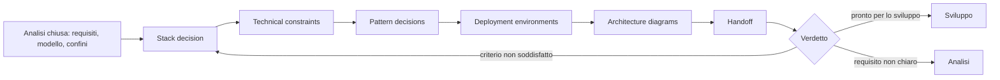

## 2. Position in the lifecycle

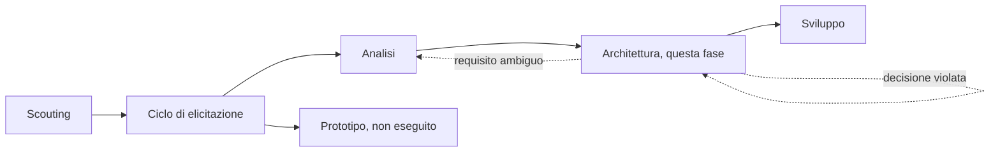

Il prototipo non è stato eseguito: l'esperienza congelata qui è quella del sistema in produzione, non un esito di esplorazione.

## 3. Stack at a glance

Caption: ogni slot risolto e il criterio che lo ha scelto. Il profilo completo è in [StackProfile](StackProfile.md) (StackProfile.md).

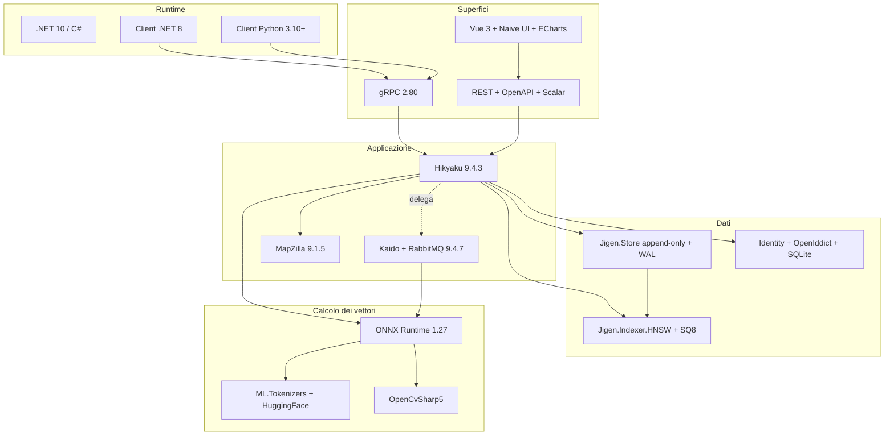

## 4. Deployable units and data ownership

Caption: le unità distribuibili, i dati posseduti e le copie derivate dichiarate. Un solo proprietario per dato.

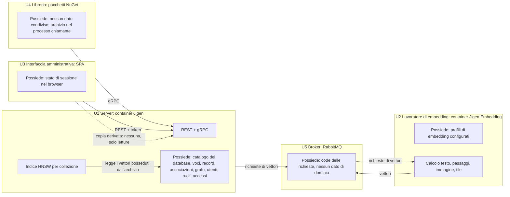

Copie derivate dichiarate: i campioni di stato (calcolati dal server), i risultati calibrati nel client (calcolati dai risultati già ottenuti), il nome utente dentro l'accesso al database (copia dell'identità).

## 5. Module and layering shape

Caption: quattro progetti per modulo, dipendenze a senso unico, composizione a runtime.

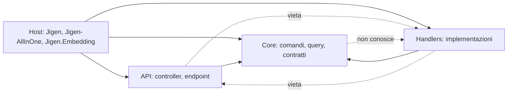

Regola: un modulo non referenzia il progetto interno di un altro modulo; parla solo con i contratti di `Core` o con il proprio host. La composizione avviene a runtime tramite il caricatore dei moduli.

## 6. Write path

Caption: dal chiamante alla durabilità, con i punti in cui può fallire.

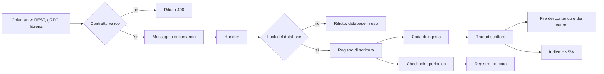

## 7. Search path

```mermaid
flowchart LR
  Q["Query: vettore o testo"] --> T{"Testo"}
  T -- "sì" --> EM{"Calcolo locale o delegato"}
  EM -- "locale" --> O1["ONNX Runtime nel processo"]
  EM -- "delegato" --> K["Kaido su RabbitMQ"]
  K --> O2["Lavoratore ONNX"]
  O1 --> V["Vettore della query"]
  O2 --> V
  T -- "no" --> V
  V --> S["Indice della collezione"]
  S --> R{"Ricerca esatta o approssimata"}
  R -- "approssimata" --> G["Visita del grafo con larghezza efSearch"]
  R -- "esatta" --> B["Confronto con tutte le voci"]
  G --> RR["Ripristino esatto dei punteggi"]
  RR --> F{"Filtro"}
  F -- "sì" --> FL["Predicato sulle proprietà della voce"]
  F -- "no" --> T2["Top k"]
  FL --> T2
  B --> T2
  T2 --> M{"Raggruppamento per record condiviso"}
  M -- "sì" --> MG["Un risultato per record, budget di candidati"]
  M -- "no" --> OUT["Risultati con chiave, contenuto e punteggio"]
  MG --> OUT
```

## 8. Identity and authorization path

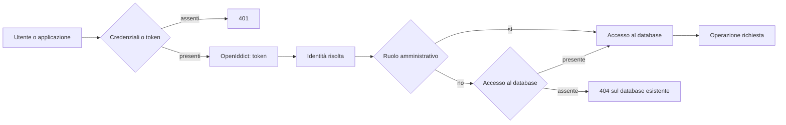

Il rifiuto per database non autorizzato è `404`, non `403`: il database non associato non è osservabile. La regola è decisa una volta e vale su entrambe le superfici.

## 9. Environments and promotion

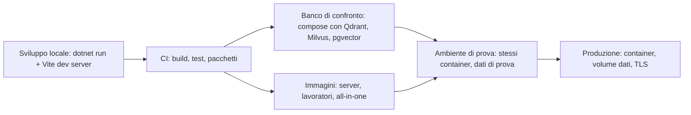

## 10. Canonical model, frozen

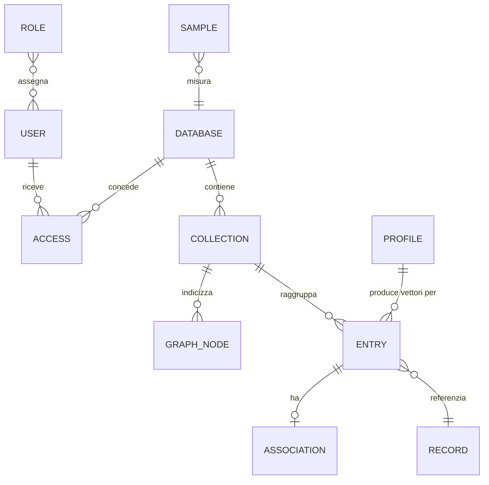

Il modello è quello dell'analisi, congelato. Il grafo resta separato dalla voce: possiede nodi e adiacenze e legge i vettori dall'archivio.

## 11. Data sources, actors and output types

Caption: le fonti dell'architettura, chi le produce e i tipi di output.

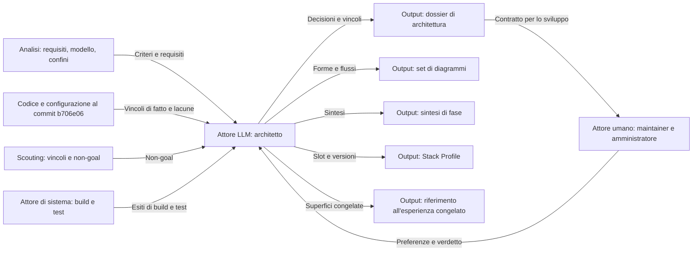

## 12. Management services per step

Caption: il flusso logico della fase, i dati scambiati e il percorso delle deviazioni.

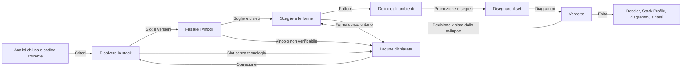

## 13. Service data flows grouped by deployment

Caption: le unità distribuite, i flussi e le copie derivate. Include le tre topologie decise.

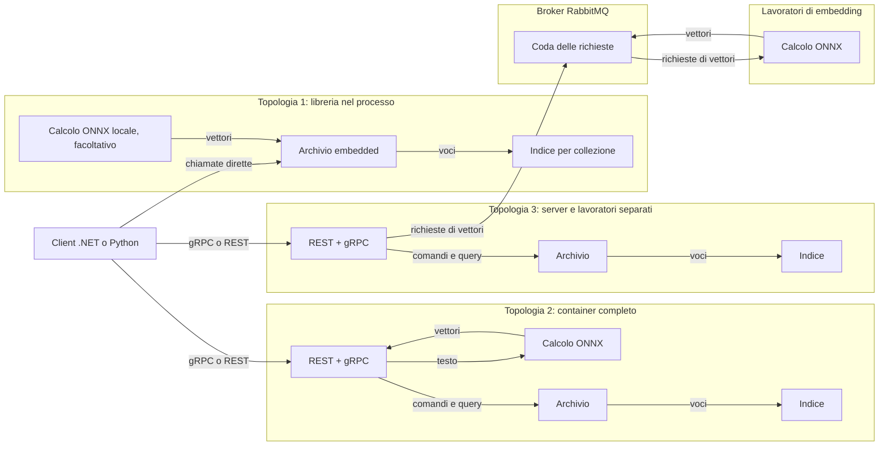

## 14. Gaps

| Lacuna | Effetto | Dove si chiude |
| --- | --- | --- |
| La SPA non è confezionata in `wwwroot`: la cartella contiene solo un segnaposto | La superficie S-04 non è distribuita con il server | T-13 e T-14 |
| Il provider `Microsoft.Extensions.VectorData` non esiste nel repository | R-30 non è soddisfatto oggi | T-12 |
| Le tre rotte di menu dell'interfaccia non hanno un corrispondente nel server | Il menu dipende da chiamate che falliscono | T-14 |
| La superficie REST `search-filter` ignora il filtro | Nessun requisito la copre | T-08: rimozione decisa |
| Nessuna verifica di accessibilità | L'obiettivo WCAG 2.2 AA non è misurato | T-14 |
| Il registro di scrittura non è configurato dal server | La durabilità di R-12 dipende dalla configurazione | T-02 e T-13, con K-06 che lo attiva per default |
