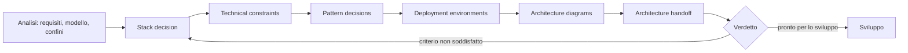

# Architecture dossier

## Architecture diagrams

Preferenza di lettura ereditata dall'analisi: diagram-first. Il set completo è in [Architecture diagrams](diagrams.md) (diagrams.md).

Indice:

1. [Phase flow](diagrams.md#1-phase-flow) (diagrams.md#1-phase-flow)
2. [Position in the lifecycle](diagrams.md#2-position-in-the-lifecycle) (diagrams.md#2-position-in-the-lifecycle)
3. [Stack at a glance](diagrams.md#3-stack-at-a-glance) (diagrams.md#3-stack-at-a-glance)
4. [Deployable units and data ownership](diagrams.md#4-deployable-units-and-data-ownership) (diagrams.md#4-deployable-units-and-data-ownership)
5. [Module and layering shape](diagrams.md#5-module-and-layering-shape) (diagrams.md#5-module-and-layering-shape)
6. [Write path](diagrams.md#6-write-path) (diagrams.md#6-write-path)
7. [Search path](diagrams.md#7-search-path) (diagrams.md#7-search-path)
8. [Identity and authorization path](diagrams.md#8-identity-and-authorization-path) (diagrams.md#8-identity-and-authorization-path)
9. [Environments and promotion](diagrams.md#9-environments-and-promotion) (diagrams.md#9-environments-and-promotion)
10. [Canonical model, frozen](diagrams.md#10-canonical-model-frozen) (diagrams.md#10-canonical-model-frozen)
11. [Data sources, actors and output types](diagrams.md#11-data-sources-actors-and-output-types) (diagrams.md#11-data-sources-actors-and-output-types)
12. [Management services per step](diagrams.md#12-management-services-per-step) (diagrams.md#12-management-services-per-step)
13. [Service data flows grouped by deployment](diagrams.md#13-service-data-flows-grouped-by-deployment) (diagrams.md#13-service-data-flows-grouped-by-deployment)

Diagrammi non applicabili: nessuno. Lacune del set: vedi [Architecture diagrams](diagrams.md#14-gaps) (diagrams.md#14-gaps).

## Stack decision

**Input.** Le nove decisioni lasciate aperte dalla [Technical analysis](../analysis/dossier.md#technical-analysis) (analysis/dossier.md#technical-analysis), con i criteri che le vincolano, più la forma della superficie emersa dal confronto con il codice.

**Esito.** Ogni slot ha una tecnologia; il profilo completo, con versioni e criterio, è in [Stack Profile](StackProfile.md) (StackProfile.md).

| Slot richiesto dall'analisi | Scelta | Perché soddisfa il criterio |
| --- | --- | --- |
| Piattaforma di esecuzione | .NET 10 / C# | Un solo linguaggio per nucleo, indici, superfici e calcolo ONNX; il calcolo locale è una libreria dello stesso runtime |
| Archivio su file | Jigen.Store proprietario | Append-only, mappatura in memoria e lock esclusivo sono il contratto dell'archivio, non un adattamento |
| Indice approssimato | Jigen.Indexer.HNSW proprietario | Grafo su file mappato, inserimenti concorrenti, tombstone e SQ8 vivono nello stesso progetto |
| Calcolo dei vettori | ONNX Runtime con provider selezionabile a build e a runtime | Stessi modelli su CPU e acceleratori, con ripiego su CPU quando la registrazione fallisce |
| Trasporto fra server e lavoratori | RabbitMQ via Hikyaku.Kaido | Consegna affidabile e più consumatori concorrenti; entra solo con la delega attiva |
| Identità | ASP.NET Core Identity + OpenIddict + SQLite | Token, ruoli e client senza introdurre un servizio esterno obbligatorio |
| Interfaccia amministrativa | Vue 3 + Naive UI + ECharts | Tabelle, grafi e temi con una sola lingua; consuma la superficie REST già esposta |
| Forma della distribuzione | Tre topologie: libreria, container completo, server e lavoratori separati | Il calcolo dei vettori cresce separatamente, l'archivio resta unitario |
| Formato degli artefatti | NuGet per le librerie, immagini OCI per le topologie | Installazione nel processo e avvio in container dallo stesso codice |
| Forma della superficie | REST e gRPC sullo stesso dispatcher | Parità di comportamento fra superficie testuale e binaria |

**Alternative scartate.** Non sono conservate: la scelta è una sola per slot e il criterio che l'ha esclusa resta nel criterio, non in una nota.

**Criteri respinti.**

| Criterio | Motivo del rifiuto | Cosa lo riaprirebbe |
| --- | --- | --- |
| Due lingue dell'interfaccia | Nessun requisito lo chiede: il codice ne ha una e l'analisi registra la seconda lingua come lacuna, non come obiettivo. | Un requisito di internazionalizzazione con criteri di accettazione. |

**Cosa questa decisione rende impossibile.**

- Sostituire l'archivio o l'indice senza riscrivere le operazioni: entrambi sono nella stessa soluzione e nello stesso linguaggio.
- Distribuire il calcolo dei vettori senza un broker: la delega passa da Kaido.
- Eseguire il server senza .NET 10.

## Technical constraints

Vincoli verificabili. Un vincolo senza soglia, cancello o divieto non è un vincolo.

**Piattaforma e struttura.**

| Id | Vincolo | Verifica |
| --- | --- | --- |
| K-01 | Ogni progetto server e libreria ha `TargetFramework` `net10.0`; il client .NET `net8.0`. | Build della soluzione; ispezione dei `.csproj`. |
| K-02 | Le dipendenze fra progetti vanno Host → API e Handlers → Core. Un progetto non referenzia `Handlers` o `API` di un altro modulo. | Ispezione dei `ProjectReference` in revisione. |
| K-03 | La composizione dei moduli avviene a runtime; l'host non elenca i moduli a mano. | Avvio con un modulo assente dalla composizione: il server parte senza quel modulo. |
| K-04 | Le immagini non `cpu` si costruiscono con `-p:JigenOnnxRuntimeFlavor=Gpu`, `DirectML` o `OpenVino`. | Build dedicata; avvio con provider non disponibile: ripiego su CPU. |

**Dati e durabilità.**

| Id | Vincolo | Verifica |
| --- | --- | --- |
| K-05 | Un solo processo per database. | Seconda apertura sullo stesso percorso: fallisce, la prima resta operativa. |
| K-06 | Il registro di scrittura è attivo per default nel server, con durabilità `Group` (10 ms o 8 record). | Configurazione del server e test di arresto non pulito. |
| K-07 | Nessun dato di dominio in un secondo proprietario: l'indice possiede solo nodi e adiacenze e legge i vettori dall'archivio. | Ispezione dei tipi persistiti per progetto. |
| K-08 | Il contenuto di un record condiviso è del database; l'associazione è della collezione. Eliminare una voce elimina la sua associazione, non il contenuto. | Test di eliminazione con due voci sullo stesso record. |
| K-09 | I formati persistiti sono versionati e una modifica richiede una migrazione dichiarata. | Apertura di un archivio della versione precedente. |
| K-10 | Un database non associato all'utente risponde `404`, non `403`. | Matrice utente × database. |

**Prestazioni e richiamo.**

| Id | Vincolo | Verifica |
| --- | --- | --- |
| K-11 | Ricerca in-process P50 ≤ 3 ms su 100.000 vettori a 128 dimensioni. | Banco `JigenBenchmarks`. |
| K-12 | Ingesta in blocco ≥ 90.000 vettori al secondo senza costruzione del grafo. | Banco `JigenBenchmarks`. |
| K-13 | Richiamo ≥ 0,95 a 100.000 vettori con larghezza di ricerca 100, misurato contro la ricerca esatta su dati reali. | Banco con richiamo calcolato; oggi il valore su vettori casuali è 0,80 a larghezza 80. |
| K-14 | Riapertura di 100.000 vettori in ≤ 1 s. | Banco di riapertura. |
| K-15 | Heap gestito ≤ 150 MB per 100.000 vettori. Il server impone un limite di heap configurabile, 2048 MB per default. | Misura del banco e `GCHeapHardLimit` all'avvio. |

**Sicurezza.**

| Id | Vincolo | Verifica |
| --- | --- | --- |
| K-16 | Ogni superficie è autenticata. Rotte anonime ammesse: salute, documentazione OpenAPI e Scalar, rotte di accesso (`/api/connect/*`, `/api/identity/login`). | Elenco delle rotte anonime confrontato con gli attributi dei controller. |
| K-17 | Nessuna credenziale predefinita in produzione: utente seminato, segreto del client e credenziali del broker. L'avvio rifiuta i valori pubblicati. | Avvio in `Production` con i valori di esempio: fallisce. |
| K-18 | TLS obbligatorio in produzione, terminato dal server o da un terminatore dichiarato. | Configurazione dell'ambiente. |
| K-19 | CORS limitato alle origini configurate; l'elenco vuoto non consente origini arbitrarie. | Richiesta da origine non in elenco: rifiutata. |
| K-20 | Le eccezioni non attraversano il confine: l'intercettore gRPC e il mapping HTTP non espongono tracce di stack. | Risposta a un errore interno: codice e messaggio, nessuna traccia. |
| K-21 | Nessuna telemetria verso terzi. | Ispezione delle dipendenze e della configurazione. |

**Dati personali.**

| Id | Vincolo | Verifica |
| --- | --- | --- |
| K-22 | Dati personali trattati: nome utente, credenziali in hash, ruoli, accessi ai database. Nessun altro. | Ispezione del modello di identità. |
| K-23 | L'eliminazione di un utente rimuove credenziali e accessi; il contenuto delle voci si elimina per chiave. | Test di eliminazione. |
| K-24 | I file dei modelli sono dati di configurazione, non dati dell'utente. | Ispezione del volume `/data/onnx`. |

**Interfaccia, accessibilità e lingua.**

| Id | Vincolo | Verifica |
| --- | --- | --- |
| K-25 | S-04 raggiunge WCAG 2.2 AA sulle superfici esistenti. | Verifica con tastiera e controllo automatico; nessun controllo oggi. |
| K-26 | Una sola lingua: inglese (`en-us`). Nessuna seconda lingua in questo ciclo. | Elenco delle lingue nel repository. |
| K-27 | Il menu è statico nella SPA: nessuna chiamata al server per costruirlo. | Ispezione delle chiamate della SPA. |
| K-28 | Le etichette dell'interfaccia sono quelle congelate nel [riferimento all'esperienza](../ux-reference.md) (ux-reference.md). | Confronto fra schermate e vocabolario. |

**Test e qualità.**

| Id | Vincolo | Verifica |
| --- | --- | --- |
| K-29 | Ogni progetto ha test xUnit; ogni operazione esposta esiste su entrambe le superfici con lo stesso esito. | Suite `Jigen.API.Tests`, `Jigen.Grpc.Tests`. |
| K-30 | Il registro di scrittura, le transazioni e la compattazione hanno test di arresto non pulito. | Suite `JigenStoreTests`. |
| K-31 | Il richiamo dell'indice è confrontato con la ricerca esatta a ogni modifica dell'indice. | Suite `HnswTest`. |
| K-32 | Il client Python passa `pytest`, `ruff` e `mypy`. | CI del client. |
| K-33 | La SPA passa `vue-tsc`, lint e build prima del rilascio. | CI dell'interfaccia. |

**Licenze.**

| Id | Vincolo | Verifica |
| --- | --- | --- |
| K-34 | Solo dipendenze con licenza permissiva compatibile con la ridistribuzione del pacchetto e dell'immagine. | Revisione della licenza alla prima introduzione della dipendenza. |

## Pattern decisions

Ogni forma dichiara il vincolo o il requisito che la impone.

| Id | Forma | Traccia |
| --- | --- | --- |
| P-01 | Monolite modulare con quattro progetti per modulo (Host, API, Core, Handlers) e composizione a runtime. | K-02, K-03 |
| P-02 | Un solo dispatcher per entrambe le superfici: i controller e i servizi RPC traducono soltanto. | R-21, K-29 |
| P-03 | Comandi e query separati; nessuno stato condiviso fra i due lati. | R-02…R-11 |
| P-04 | Scrittore singolo per database: coda di ingesta, thread scrittore, checkpoint; lettori in mappatura senza lock. | R-01, R-12, R-13, K-05 |
| P-05 | Indice fuori dal percorso critico della scrittura: operazioni accodate a worker, costruzione differita sotto soglia. | R-06, R-27, K-12 |
| P-06 | Archivio e indice separati per proprietà: il primo possiede contenuti e vettori, il secondo nodi e adiacenze. | K-07 |
| P-07 | Record condivisi divisi fra contenuto del database e associazione della collezione, con ricerca raggruppata a budget obbligatorio. | R-10, R-11, K-08 |
| P-08 | Calcolo dei vettori come porta con due adattatori: generatore locale ONNX e generatore accodato verso i lavoratori. | R-07, R-28, K-04 |
| P-09 | Delega come messaggio, non come chiamata diretta: il server pubblica la richiesta e attende la risposta. | R-28 |
| P-10 | Identità come confine separato: token OpenIddict, ruoli, accesso per database applicato nell'handler. | R-23…R-25, K-10 |
| P-11 | Osservazione come copia derivata in memoria, con finestre fisse. | R-26 |
| P-12 | Client come proxy generato più facciata tipizzata per collezione; nessuna logica di dominio nel client. | R-29 |
| P-13 | Fusione cross-modale nel client, con calibrazione per gruppo e punteggio grezzo conservato. | R-35 |
| P-14 | SPA statica servita dalla stessa origine del server, che ne è l'unico backend. | R-32, R-33, K-27 |
| P-15 | Rimozione della superficie REST `search-filter`: nessun requisito la copre e il filtro è disponibile su S-01 e S-03. | R-08 |
| P-16 | Errori: `400` contratto non valido, `401` non autenticato, `404` database o chiave non accessibile, `409` conflitto di identità, `423` database in uso, `5xx` errore interno. | R-02, R-23, K-10, K-20 |

**Forma distribuita.** Le tre topologie rispondono al criterio registrato nell'analisi: il calcolo dei vettori cresce separatamente perché è limitato da CPU o acceleratore, l'archivio resta unitario perché nessun requisito chiede replica o scala orizzontale.

| Unità | Dati posseduti | Copie derivate |
| --- | --- | --- |
| Server | Catalogo, voci, record, associazioni, grafo, utenti, ruoli, accessi | Campioni di stato |
| Lavoratore | Profili di embedding configurati | Nessuna |
| SPA | Stato di sessione nel browser | Nessuna |
| Libreria | Archivio nel processo chiamante | Nessuna |
| Broker | Code delle richieste | Nessuna |

## Deployment environments

| Ambiente | Cosa esegue | Cosa differisce |
| --- | --- | --- |
| Sviluppo locale | Server `dotnet run` su 3223 e 13223, SPA Vite che legge l'indirizzo del servizio da `public/settings.json`, SQLite in `App_Data`, dati in `/data/jigendb` | Log dettagliati, TLS assente, calcolo locale, utente seminato ammesso |
| CI | Build, test e pacchetti su GitHub Actions | Nessun dato, credenziali di prova, versioni dai tag |
| Banco di confronto | Compose con server, Qdrant, Milvus e pgvector | Volume di benchmark in sola lettura, nessuna identità reale |
| Prova | Container del server, dei lavoratori e del broker | TLS, credenziali proprie, dati di prova |
| Produzione | Container con volume `/data`, TLS, segreti iniettati | Nessuna credenziale predefinita, WAL attivo, calcolo delegato o locale secondo capacità |

**Configurazione.** Le opzioni stanno in `appsettings.json` e si sovrascrivono da variabili d'ambiente con la sintassi `Sezione__Chiave`. Sezioni: `JigenServer`, `JigenEmbeddings`, `JigenIdentity`, `Kaido`, `RabbitMQ`.

**Segreti.** Chiave NuGet, password del broker, certificato TLS e relativa password, utente seminato, segreto del client OIDC. Mai nell'immagine né nel repository: variabili d'ambiente o file montato.

**Dati.** `/data/jigendb` per i database, `/data/onnx` per i modelli, `App_Data/identity.db` per l'identità. Nessun dato dentro l'immagine. Il backup è una copia del volume a server fermo: lo scrittore singolo non consente una copia coerente a caldo.

**Percorso di promozione.** Tag `v*` → pacchetti NuGet e immagini → prova con dati di prova e verifica di avvio → produzione. Nessuna conversione silenziosa dei dati: una versione con formato incompatibile rifiuta l'avvio.

## Experience reference, frozen

Il [riferimento all'esperienza](../ux-reference.md) (ux-reference.md) è congelato con questo giro. Lo sviluppo lo consuma e non inventa superfici, punti di ingresso, navigazione, stati o vocabolario.

| Elemento congelato | Valore |
| --- | --- |
| Superfici | S-01 in-process, S-02 REST, S-03 binaria, S-04.1…S-04.8, S-05 artefatti |
| Navigazione | Menu statico a sette voci più accesso; dal dettaglio di una collezione verso workbench ed esploratore |
| Punto di ingresso di ogni flusso | Come registrato nel riferimento, invariato |
| Stati per superficie | Caricamento, vuoto, inattivo, invariati |
| Direzione per superficie | Quella in uso nel sistema esistente, non validata da un prototipo |
| Vocabolario | Etichette inglesi congelate; «Document» è l'etichetta di Voce |
| Lingua | Una sola, inglese |

**Divergenze dal riferimento ammesse.** Nessuna oltre quelle già registrate nel riferimento. Una superficie nuova o un'etichetta nuova richiede un ritorno all'analisi.

## Architecture handoff

**Verdetto.** L'architettura è completa e pronta per lo sviluppo.

**Lista di prontezza.**

| Voce | Esito |
| --- | --- |
| Ogni slot richiesto dall'analisi ha una tecnologia o è dichiarato assente | Sì, [Stack Profile](StackProfile.md) (StackProfile.md). |
| Ogni vincolo è verificabile | Sì, K-01…K-34. |
| Ogni forma traccia un vincolo o un requisito | Sì, P-01…P-16. |
| Il modello canonico è congelato e rispettato dalle unità distribuite | Sì, un proprietario per dato, copie derivate dichiarate. |
| Il riferimento all'esperienza è congelato | Sì, [riferimento all'esperienza](../ux-reference.md) (ux-reference.md). |
| Gli ambienti e la politica dei segreti sono dichiarati | Sì, [Deployment environments](#deployment-environments) (dossier.md#deployment-environments). |
| Le due viste di flusso richieste e la vista per deployment esistono | Sì, diagrammi 11, 12 e 13. |

**Deciso e non da riaprire.**

- Stack, versioni e slot assenti.
- Vincoli K-01…K-34.
- Forme P-01…P-16, compresa la rimozione di `search-filter` e il menu statico.
- Tre topologie di distribuzione e proprietà dei dati per unità.
- Ambienti, promozione, politica di segreti e dati.
- Superfici, navigazione, stati e vocabolario dell'esperienza.

**Obblighi che lo sviluppo eredita.**

| Obbligo | Pacchetto |
| --- | --- |
| Abilitare il registro di scrittura per default nel server e coprirlo con test di arresto non pulito | T-02, T-13 |
| Confezionare la SPA costruita dentro `wwwroot` e servirla dalla stessa origine | T-13, T-14 |
| Rimuovere la superficie REST `search-filter` e le tre chiamate di menu inesistenti | T-08, T-14 |
| Implementare il provider `Microsoft.Extensions.VectorData` | T-12 |
| Rifiutare all'avvio le credenziali predefinite in produzione e limitare CORS alle origini configurate | T-09, T-13 |
| Verificare WCAG 2.2 AA sulle superfici esistenti | T-14 |
| Misurare il richiamo su dati reali e fissare i valori predefiniti dell'indice | T-04 |

**Domande che tornano all'analisi.** Nessuna bloccante. Il richiamo su dati reali resta la domanda P2 dello scouting: la misura non cambia il comportamento richiesto, cambia i valori predefiniti dell'indice, che sono una decisione di architettura già tracciata.
