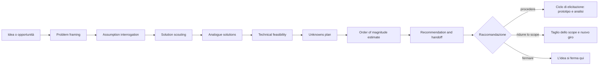
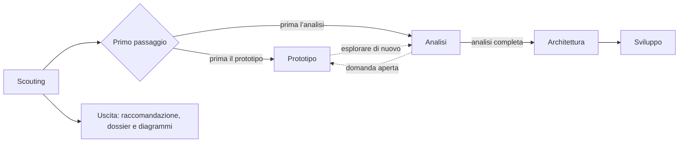
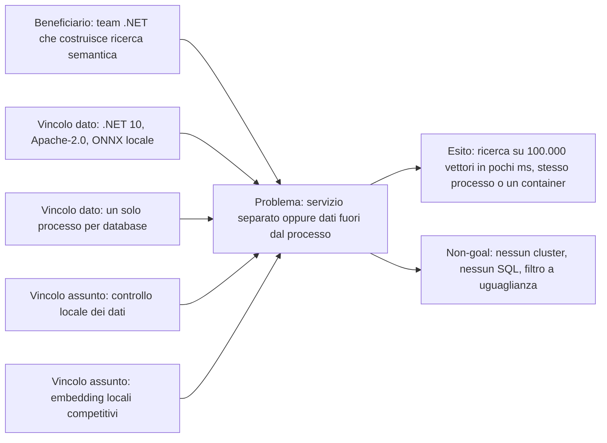
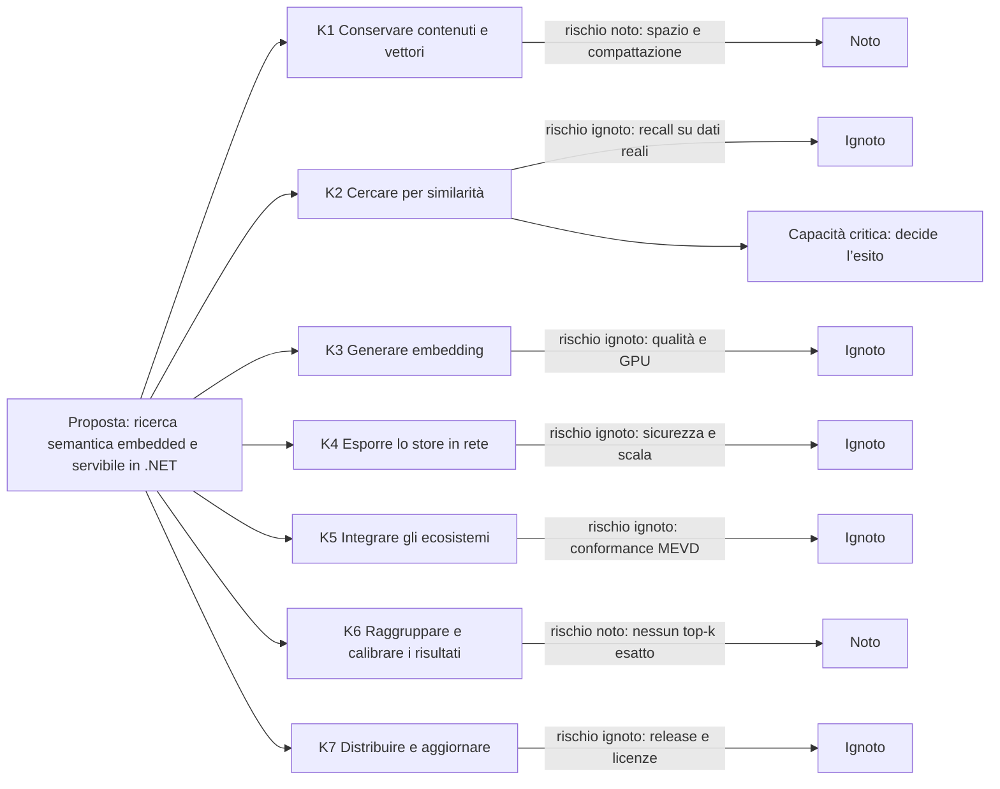
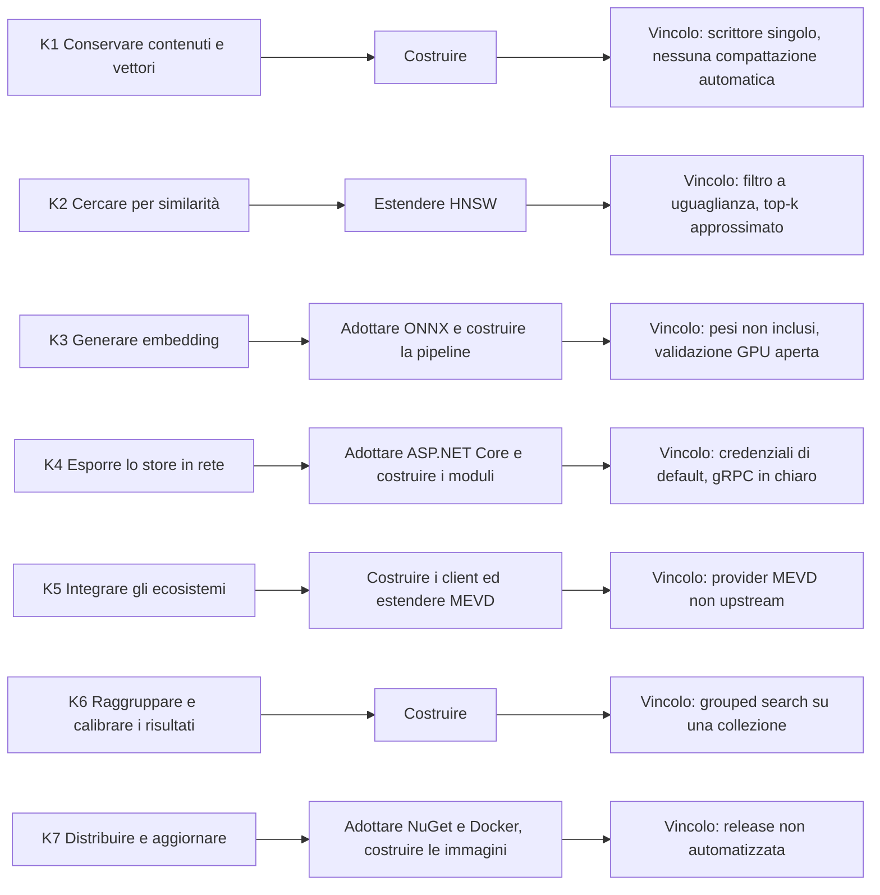
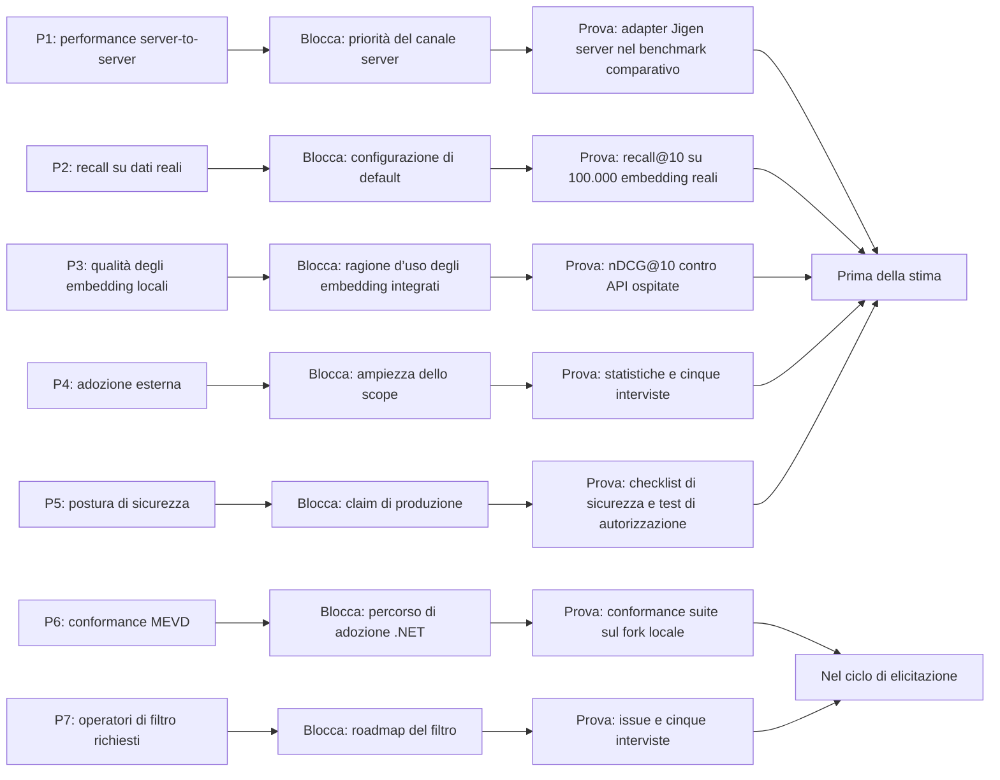
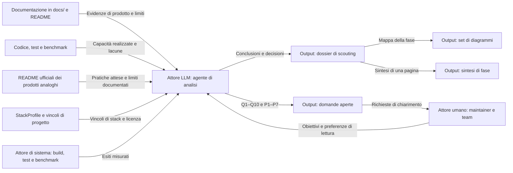
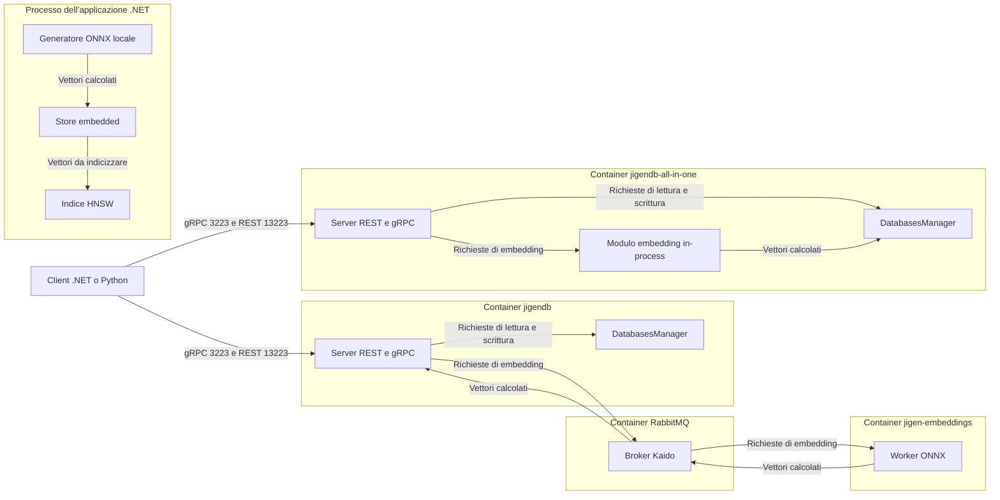

# Scouting diagrams

Preferenza di lettura: diagram-first. I diagrammi usano il tema predefinito del renderer. Nessuna palette personalizzata, quindi il contrasto non è misurato: va verificato nel tema di visualizzazione adottato.

## Index

1. [Phase flow](#1-phase-flow)
2. [Position in the lifecycle](#2-position-in-the-lifecycle)
3. [Problem and outcome frame](#3-problem-and-outcome-frame)
4. [Capability and risk map](#4-capability-and-risk-map)
5. [Adopt-extend-build map](#5-adopt-extend-build-map)
6. [Question and proof map](#6-question-and-proof-map)
7. [Data sources, actors and output types](#7-data-sources-actors-and-output-types)
8. [Management services per step](#8-management-services-per-step)
9. [Service data flows grouped by deployment](#9-service-data-flows-grouped-by-deployment)

## 1. Phase flow

Caption: i passi della fase in ordine, la sezione che ciascuno scrive e i tre esiti della raccomandazione.

## 2. Position in the lifecycle

Caption: dove sta la fase di scouting, cosa consegna e quale uscita la chiude.

## 3. Problem and outcome frame

Caption: beneficiario, problema, esito osservabile, vincoli dati o assunti e non-goal correnti.

## 4. Capability and risk map

Caption: le capacità, il rischio dominante di ciascuna marcato noto o ignoto, e la capacità che decide l’esito.

## 5. Adopt-extend-build map

Caption: la decisione corrente per ogni capacità e il vincolo che la limita.

## 6. Question and proof map

Caption: ogni domanda sopravvissuta, la decisione che blocca, la prova minima che la chiude e il momento in cui va eseguita.

## 7. Data sources, actors and output types

Caption: le fonti usate dall’analisi, gli attori che le producono o le leggono e i tipi di output della fase.

## 8. Management services per step

Caption: il flusso logico della fase, con le responsabilità di gestione, i dati scambiati e il percorso delle domande senza risposta.

```mermaid
flowchart LR
  IN["Documentazione, codice, benchmark e fonti esterne"] -->|"Materiale da leggere"| E["Raccolta e lettura delle evidenze"]
  E -->|"Fatti e citazioni"| F["Framing del problema"]
  F -->|"Problema, vincoli, non-goal"| I["Interrogazione delle ipotesi"]
  I -->|"Ipotesi falsificabili"| S["Ricerca di soluzioni e analoghi"]
  S -->|"Decisioni adottare, estendere, costruire"| T["Valutazione di fattibilità"]
  T -->|"Rischi noti e ignoti"| U["Piano delle prove"]
  U -->|"Domande e prove"| M["Stima per capacità"]
  M -->|"Intervallo e incertezza"| R["Raccomandazione"]
  R -->|"Esito esplicito"| OUT["Dossier, diagrammi e sintesi"]
  I -->|"Domande senza risposta"| GAP["Domande aperte"]
  T -->|"Rischio non chiuso"| GAP
  GAP -->|"Q1–Q10 e P1–P7"| U
  S -->|"Candidato rifiutato"| GAP
```

## 9. Service data flows grouped by deployment

Caption: le unità di deployment documentate e i flussi tra esse. Il diagramma rappresenta la documentazione corrente, non una nuova decisione.

## Gaps

- Il diagramma 9 non mostra la UI amministrativa Jigen Insight, fuori scope documentale.
- Nessun diagramma mostra l’adozione esterna: non esistono dati di telemetria o di utilizzo.
- Il diagramma 6 copre le domande sopravvissute dopo l’interrogazione. Q6 e Q10 restano nel ciclo di elicitazione e non hanno una prova pianificata in questa fase.
- Il contrasto dei colori non è misurato. I diagrammi non usano palette personalizzate.
