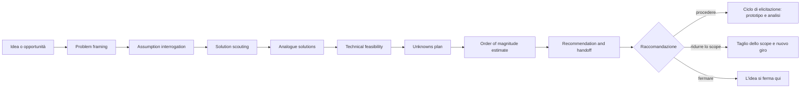

# Scouting dossier

## Scouting diagrams

Preferenza di lettura registrata: diagram-first. Il dossier apre con la mappa della fase; i diagrammi completi stanno in [Scouting diagrams](diagrams.md) (diagrams.md).

Indice del set:

1. [Phase flow](diagrams.md#1-phase-flow) (diagrams.md#1-phase-flow)
2. [Position in the lifecycle](diagrams.md#2-position-in-the-lifecycle) (diagrams.md#2-position-in-the-lifecycle)
3. [Problem and outcome frame](diagrams.md#3-problem-and-outcome-frame) (diagrams.md#3-problem-and-outcome-frame)
4. [Capability and risk map](diagrams.md#4-capability-and-risk-map) (diagrams.md#4-capability-and-risk-map)
5. [Adopt-extend-build map](diagrams.md#5-adopt-extend-build-map) (diagrams.md#5-adopt-extend-build-map)
6. [Question and proof map](diagrams.md#6-question-and-proof-map) (diagrams.md#6-question-and-proof-map)
7. [Data sources, actors and output types](diagrams.md#7-data-sources-actors-and-output-types) (diagrams.md#7-data-sources-actors-and-output-types)
8. [Management services per step](diagrams.md#8-management-services-per-step) (diagrams.md#8-management-services-per-step)
9. [Service data flows grouped by deployment](diagrams.md#9-service-data-flows-grouped-by-deployment) (diagrams.md#9-service-data-flows-grouped-by-deployment)

Diagrammi non applicabili: nessuno.

Vista raggruppata per deployment: inclusa. Le topologie sono documentate in [Deployment topologies](../../../docs/server/overview.md#deployment-topologies) (server/overview.md#deployment-topologies) e in [Docker](../../../docs/server/docker.md) (server/docker.md); il diagramma le rappresenta senza aggiungere decisioni.

Lacune del set:

- Nessun dato di adozione o telemetria d’uso: il diagramma delle sorgenti mostra solo le fonti disponibili.
- Il flusso di deployment riflette la documentazione corrente, non una scelta presa in questa fase.
- Contrasto dei colori non misurato: i diagrammi usano il tema predefinito del renderer, senza palette personalizzate.

Nessuna decisione: il set riflette il contenuto del dossier.

## Problem framing

**Problema.** Chi costruisce ricerca semantica dentro un’applicazione deve aggiungere un servizio separato, con rete, deployment e competenze nuove, oppure rinunciare a tenere dati e calcolo nel proprio processo.

**Beneficiario.** Un team che sviluppa un’applicazione con ricerca semantica o recupero documentale e vuole mantenere dati e calcolo sotto il proprio controllo. Osserva l’esito quando la funzione di ricerca gira senza servizi aggiuntivi, oppure con un solo container, e rispetta latenza e recall misurati.

**Esito osservabile.**

- Una ricerca su 100.000 vettori risponde in pochi millisecondi con recall misurato e dichiarato.
- La funzione gira nello stesso processo o contro un container, senza dipendenze obbligatorie ulteriori.
- Un team esterno adotta l’artefatto e lo usa in produzione.

I benchmark documentati coprono i primi due punti. Il terzo non è misurato ed è una domanda aperta.

**Vincoli.**

| Vincolo | Stato | Fonte |
| --- | --- | --- |
| .NET 10 e C# per engine e indici | dato | [Stack Profile](../../../docs/StackProfile.md) (docs/StackProfile.md) |
| .NET 8 o superiore per il client | dato | [Client getting started](../../../docs/client/getting-started.md) (client/getting-started.md) |
| Licenza Apache-2.0 | dato | [README](../../../README.md) (README.md) |
| ONNX Runtime 1.27 e modelli locali | dato | [Stack Profile](../../../docs/StackProfile.md) (docs/StackProfile.md) |
| Un solo processo per database, con lock esclusivo | dato | [In-process overview](../../../docs/in-process/overview.md) (in-process/overview.md) |
| Artefatti già pubblicati su NuGet e Docker Hub | dato | [Index](../../../docs/index.md) (docs/index.md) |
| Build della soluzione con `-m:1` | dato | [README](../../../README.md) (README.md) |
| Il segmento privilegia il controllo locale dei dati | assunto | nessuna fonte |
| Gli embedding locali sono competitivi con le API ospitate | assunto | nessuna fonte |
| Il maintainer persegue l’adozione, non il ricavo immediato | assunto | nessuna fonte |
| La superficie attuale è sostenibile da una persona | assunto | nessuna fonte |
| Il vantaggio di performance regge anche server-to-server | assunto | nessuna fonte |

**Non-goal.**

- Nessun cluster distribuito e nessuna replica: il server apre database locali su un host.
- Nessun linguaggio SQL e nessun join relazionale.
- Nessun operatore di filtro oltre uguaglianza, appartenenza a collezione, AND e OR.
- Nessuna garanzia di top-k esatto nel grouped search.
- Nessuna conversione tra spazi di embedding diversi.
- Nessun supporto per immagini GIF.
- Nessun provider Vulkan.
- Nessuna documentazione della UI amministrativa Jigen Insight.

**Domande aperte, ordinate per impatto.**

1. Q1: il beneficiario è un singolo sviluppatore, un team aziendale o il maintainer stesso? La risposta cambia la metrica di successo.
2. Q2: quale segnale misura l’adozione: download NuGet, issue di terzi, deploy documentati, citazioni dei benchmark?
3. Q3: il vantaggio di performance deve reggere server-to-server o basta il confronto embedded?
4. Q4: la qualità degli embedding locali è competitiva con le API ospitate per il segmento scelto?
5. Q5: quali operatori di filtro servono davvero agli utilizzatori?
6. Q6: la scala orizzontale è richiesta o il singolo host basta?
7. Q7: il progetto è un prodotto con supporto e SLA oppure un artefatto open source di ricerca?
8. Q8: quali client contano: solo .NET, anche Python e l’astrazione Microsoft.Extensions.VectorData?
9. Q9: il vincolo di residenza dei dati è la ragione d’uso principale?
10. Q10: il supporto GPU risponde a una richiesta reale o a un interesse tecnico?

**Decisione.** Il problema e i non-goal sono fissati. Il beneficiario resta aperto (Q1) e con lui la metrica di successo (Q2).

## Assumption interrogation

| Ipotesi | Cosa deve essere vero | Verifica che la falsifica | Se falsa invalida l’idea |
| --- | --- | --- | --- |
| Il controllo locale dei dati è il beneficio cercato | Almeno cinque team .NET citano privacy, residenza o deployment come motivo di scelta | Interviste a cinque team; se nessuno cita questi motivi, l’ipotesi cade | Sì, il posizionamento |
| Gli embedding locali sono competitivi | La qualità di recupero locale è vicina a quella delle API ospitate | Confronto di nDCG@10 tra modelli locali e API su un corpus pubblico | Sì, se l’embedding è la ragione d’uso |
| Il vantaggio di performance regge server-to-server | Jigen server resta più veloce nella stessa rete e sugli stessi dati | Benchmark con Jigen server e gli altri backend sullo stesso host | Sì, la tesi di performance |
| I default HNSW bastano su dati reali | Recall@10 accettabile senza tuning esperto | Recall@10 su un dataset pubblico di embedding reali a 100.000 vettori | Sì, se il default richiede un esperto |
| Il filtro a uguaglianza basta | Gli utilizzatori non chiedono operatori relazionali o di stringa | Analisi delle issue e cinque interviste | No, riduce l’ambito del filtro |
| Una persona sostiene la superficie | Il tempo disponibile copre sette capacità e quattro immagini Docker | Conteggio delle capacità e tempo dichiarato dal maintainer | No, impone un taglio |
| L’adozione è l’obiettivo | Il maintainer lo dichiara | Domanda diretta | Sì, cambia la raccomandazione |
| Il singolo host basta | I potenziali utilizzatori non chiedono disponibilità o scala | Requisiti dichiarati da cinque team | No, esclude la scala orizzontale |
| Il target è il team .NET | Download e issue arrivano da sviluppatori .NET | Provenienza di download e issue | No, cambia il client prioritario |
| Apache-2.0 è compatibile con le dipendenze | Tutte le dipendenze sono ridistribuibili | Revisione delle licenze di ONNX Runtime, OpenCvSharp e Hikyaku | Sì, il modello di distribuzione |

**Ipotesi che invalidano l’idea se false.** Controllo locale dei dati, qualità degli embedding locali, vantaggio server-to-server, tenuta dei default HNSW.

**Credenze non falsificabili in questa fase.** La sostenibilità da parte di una persona e la priorità dell’adozione dipendono da una dichiarazione del maintainer. Restano credenze finché non vengono dichiarate.

**Domande aperte aggiornate.** Q1, Q2, Q3, Q4, Q5, Q7 e Q8 passano al [Unknowns plan](#unknowns-plan) (dossier.md#unknowns-plan). Q9 è verificata dalle interviste di P4. Q6 e Q10 restano nel ciclo di elicitazione.

**Decisione.** Quattro ipotesi decidono la sopravvivenza dell’idea. Le prove P1, P2, P3 e P4 le verificano.

## Solution scouting

**Criterio di rifiuto, definito prima del confronto.** Un candidato è rifiutato se:

- richiede un servizio esterno obbligatorio nella modalità embedded;
- non gira in-process su .NET 10 o come container self-hosted;
- non persiste su disco senza un servizio gestito;
- ha una licenza incompatibile con la ridistribuzione Apache-2.0;
- non copre il requisito senza riscrivere il modello dati.

| Capacità | Decisione | Soluzione scelta | Vincolo attuale | Giustificazione della build |
| --- | --- | --- | --- | --- |
| K1 Conservare contenuti e vettori | build | engine append-only con file mappati in memoria, WAL, checkpoint e shared metadata | un solo processo per database; spazio non compattato automaticamente | nessuna libreria .NET offre store vettoriale con WAL, shared metadata e lock single-writer; SQLite e LiteDB sono relazionali |
| K2 Cercare per similarità | extend | HNSW come algoritmo e base di codice; brute force come default | filtro limitato a uguaglianza, appartenenza e AND/OR; nessun top-k esatto nel grouped search | la persistenza su disco, SQ8, gli inserimenti concorrenti e il filtro ACORN non esistono nella libreria di partenza |
| K3 Generare embedding | adopt + build | ONNX Runtime 1.27, Microsoft.ML.Tokenizers, OpenCvSharp, modelli Nomic, Qwen3 e SigLIP2 | pesi dei modelli non inclusi; validazione GPU su hardware target in corso | la pipeline con chunking, batching, prefissi di task, multi-modello e immagini non è disponibile come libreria |
| K4 Esporre lo store in rete | adopt + build | ASP.NET Core, gRPC, OpenAPI e Scalar, OpenIddict, EF Core SQLite, Hikyaku/Kaido, RabbitMQ, MEF | credenziali di default; gRPC in chiaro; interceptor delle eccezioni disattivati | i moduli, il `DatabasesManager` e il contratto multi-database sono specifici del progetto |
| K5 Integrare gli ecosistemi | adopt + build + extend | gRPC e protobuf, MessagePack; client .NET e Python; provider MEVD | provider MEVD nel fork locale, non upstream | l’astrazione Microsoft.Extensions.VectorData è il canale di adozione .NET e va estesa, non riscritta |
| K6 Raggruppare e calibrare i risultati | build | shared metadata, grouped search, `Jigen.Calibration` | grouped search su una sola collezione; nessuna garanzia di top-k esatto | nessun candidato copre il raggruppamento per record condiviso e la calibrazione cross-modale |
| K7 Distribuire e aggiornare | adopt + build | NuGet, immagini Docker, script di pubblicazione | nessuna automazione di release documentata; nessun inventario delle licenze | le immagini all-in-one, distribuita e GPU sono specifiche del progetto |

**Ambiti di ricerca.**

- Librerie e framework: coperto. Le dipendenze adottate sono elencate nei file di progetto.
- Servizi ospitati: valutati e rifiutati per la modalità embedded, perché introducono una dipendenza obbligatoria.
- Asset interni all’organizzazione: coperto. Il fork `ppossanzini/communitytoolkit-AI` contiene i provider MEVD `Jigen` e `JigenClient`; Hikyaku è un asset interno.
- Skill disponibili all’agente: coperto. Coprono documentazione e stima, non capacità di runtime.

**Fuori scope per decisione.** L’indice KMeans/IVF ha un progetto vuoto e nessuna implementazione. Resta fuori dal ciclo corrente.

**Decisione.** Adottare, estendere o costruire come da tabella. Nessuna build resta senza giustificazione.

## Analogue solutions

**Problema e utente della ricerca.** Ricerca semantica dentro un’applicazione .NET, senza un servizio separato e senza perdere il controllo dei dati. Utente: un team .NET che costruisce ricerca o recupero documentale.

**Diretti.**

| Analogia | Cosa fa | Cosa prova | Cosa risulta difficile | Fonte |
| --- | --- | --- | --- | --- |
| Qdrant | motore di similarità e database vettoriale in Rust, con payload e filtro esteso; offerta cloud con piano gratuito | il filtro sui payload è atteso; l’opzione gestita è parte dell’offerta | gestire un servizio separato e la sua infrastruttura | [Qdrant README](https://github.com/qdrant/qdrant/blob/master/README.md) |
| Milvus | database vettoriale Go e C++ per scala, distribuito e nativo su Kubernetes; Milvus Lite per l’avvio locale | la scala è un asse di prodotto separato; esiste una modalità leggera per iniziare | la complessità operativa della modalità distribuita | [Milvus README](https://github.com/milvus-io/milvus/blob/master/README.md) |
| pgvector | estensione PostgreSQL con indici IVFFlat e HNSW | i team preferiscono tenere i vettori accanto ai dati relazionali | con indici approssimati il filtro è applicato dopo la scansione e può restituire meno righe; HNSW occupa più memoria e costruisce più lentamente | [pgvector README](https://github.com/pgvector/pgvector/blob/master/README.md) |
| Weaviate | database vettoriale cloud-native con ricerca ibrida, multi-tenancy e RBAC; edizione community BSD-3 e parti enterprise a licenza commerciale | ricerca ibrida, isolamento e autorizzazione sono attesi in un prodotto server | licenza mista tra edizione community ed enterprise | [Weaviate README](https://github.com/weaviate/weaviate/blob/main/README.md) |

**Adiacenti.**

| Analogia | Cosa fa | Cosa prova | Cosa risulta difficile | Fonte |
| --- | --- | --- | --- | --- |
| Chroma | infrastruttura open source per AI, con client in memoria, modalità client-server e servizio cloud | l’esperienza embedded e l’API minima favoriscono l’adozione | offerta cloud e roadmap in evoluzione | [Chroma README](https://github.com/chroma-core/chroma/blob/main/README.md) |
| LanceDB | database vettoriale embedded sul formato colonnare Lance, con dati multimodali e offerta cloud | embedded e multimodale sono una categoria riconosciuta; il dato locale è un argomento di vendita | la promessa di scala su petabyte richiede un formato e un’infrastruttura dedicati | [LanceDB README](https://github.com/lancedb/lancedb/blob/main/README.md) |
| sqlite-vec | estensione SQLite in C puro per vettori float, int8 e binari, eseguibile ovunque | esiste una nicchia per la ricerca locale «abbastanza veloce» | è pre-v1 e dichiara modifiche incompatibili | [sqlite-vec README](https://github.com/asg017/sqlite-vec/blob/main/README.md) |

**Assistant.** Non applicabile. Il prodotto è infrastruttura, non una soluzione conversazionale o agentica.

**Conseguenze per questa idea.**

- Requisiti guadagnati: filtro sui payload oltre l’uguaglianza; multi-tenancy e autorizzazione nel server; avvio locale semplice; opzione gestita o almeno un percorso di deployment chiaro; ricerca ibrida con parole chiave.
- Differenziatori: implementazione nativa C# e .NET; stesso engine in-process e come server; embedding di testo e immagine nello stesso spazio; shared metadata con grouped search; fan-out multi-modello.
- Direzioni evitate: architettura a cluster distribuito; accoppiamento a un database relazionale; licenza mista; API Python-first.

**Lacuna dichiarata.** Non è stato raccolto un corpus sistematico di lamentele degli utilizzatori. Le difficoltà registrate sono limiti documentati dalle fonti ufficiali, non citazioni di utenti.

**Decisione.** I requisiti guadagnati entrano nello scope. Le direzioni evitate restano fuori.

## Technical feasibility

| Capacità | Rischio dominante | Stato | Evidenza attesa |
| --- | --- | --- | --- |
| K1 Conservare contenuti e vettori | crescita dello spazio e costo della compattazione non misurati | noto | misura dello spazio morto dopo cicli di scrittura e cancellazione |
| K2 Cercare per similarità | recall su embedding reali ai default e costo del filtro selettivo | ignoto | recall@10 su dataset pubblico a 100.000 vettori, a tre valori di efSearch |
| K3 Generare embedding | qualità del recupero rispetto alle API ospitate; validazione GPU | ignoto | confronto di nDCG@10 su corpus pubblico; esecuzione su hardware target |
| K4 Esporre lo store in rete | postura di sicurezza di produzione e scala su un solo host | ignoto | checklist di sicurezza verificata e test di autorizzazione |
| K5 Integrare gli ecosistemi | accettazione e conformance dei provider MEVD | ignoto | esito della conformance suite sul fork locale |
| K6 Raggruppare e calibrare i risultati | assenza di top-k esatto nel grouped search | noto | misura del richiamo in funzione del budget di candidati |
| K7 Distribuire e aggiornare | automazione di release e inventario delle licenze assenti | ignoto | pipeline di release e distinta delle licenze |

**Capacità critica.** K2 Cercare per similarità. Se il recall o la latenza non reggono su dati realistici, il resto della superficie non compensa.

**Conclusione.** Realizzabile con uno scope ridotto. Engine, server, client e immagini esistono e sono pubblicati. Gli unknown riguardano evidenza e robustezza di produzione, non la fattibilità tecnica.

**Decisione.** Procedere solo dopo aver chiuso P1, P2, P3, P4 e P5. K2 decide l’esito.

## Unknowns plan

| Ordine | Domanda | Decisione bloccata | Prova minima | Quando |
| --- | --- | --- | --- | --- |
| P1 | Il vantaggio di performance regge quando Jigen gira come server nella stessa rete? | priorità del canale server e tesi di performance (Q3) | aggiungere un adapter Jigen server a `tests/ComparativeBenchmarks` e ripetere 10k e 100k contro Qdrant, Milvus e pgvector sullo stesso host | prima della stima |
| P2 | I default HNSW raggiungono un recall accettabile su embedding reali? | configurazione di default e claim di qualità | 100.000 embedding reali, recall@10 a efSearch 50, 100 e 200 | prima della stima |
| P3 | Gli embedding locali sono competitivi con le API ospitate? | ragione d’uso degli embedding integrati (Q4) | confronto di nDCG@10 tra modelli locali e API ospitate su un corpus pubblico | prima della stima |
| P4 | Qualcuno usa Jigen fuori dal maintainer e per quale motivo? | ampiezza dello scope, beneficiario e metrica (Q1, Q2, Q7, Q9) | statistiche NuGet, Docker e GitHub più cinque interviste | prima della stima |
| P5 | Il server è utilizzabile in produzione senza hardening non documentato? | claim di prontezza per la produzione (Q7) | checklist su credenziali di default, TLS gRPC, interceptor e autorizzazione REST/gRPC, con un test di integrazione | prima della stima |
| P6 | I provider MEVD passano la conformance suite? | percorso di adozione .NET (Q8) | eseguire la suite sul fork locale | nel ciclo |
| P7 | Quali operatori di filtro servono davvero? | roadmap del filtro (Q5) | analisi delle issue e cinque interviste | nel ciclo |

**Costo delle prove.** Da 8 a 15 giornate-uomo, tutte le prove incluse.

**Decisione.** Eseguire P1, P2, P3, P4 e P5 prima della stima. P6 e P7 passano al ciclo di elicitazione.

## Order of magnitude estimate

| Capacità | Lavoro residuo | Giorni-uomo | Dipende da una prova aperta |
| --- | --- | --- | --- |
| K1 Conservare contenuti e vettori | misura dello spazio e della compattazione | 2–5 | no |
| K2 Cercare per similarità | benchmark like-for-like, recall reale, estensione del filtro | 10–25 | sì, P1 e P2 |
| K3 Generare embedding | confronto di qualità, validazione GPU | 5–12 | sì, P3 |
| K4 Esporre lo store in rete | baseline di sicurezza, limiti e metriche | 8–20 | sì, P5 |
| K5 Integrare gli ecosistemi | conformance MEVD, parità Python | 8–20 | sì, P6 |
| K6 Raggruppare e calibrare | misura del budget di candidati | 3–8 | no |
| K7 Distribuire e aggiornare | automazione di release, distinta delle licenze | 3–8 | no |

**Intervallo aggregato.** Da 39 a 98 giornate-uomo, cioè da due a cinque mesi per una persona. Include il costo delle prove.

**Incertezza.** Lo scope ridotto non è ancora fissato: P4 può eliminare client e capacità, P1, P2 e P3 possono cambiare la priorità di K2 e K3. La stima non è un impegno.

**Stime provvisorie.** K2, K3, K4 e K5 dipendono da prove non chiuse. K1, K6 e K7 sono stabili.

**Cosa abbassa il limite superiore.**

- Chiudere P1, P2 e P3 con esito positivo: elimina la parte alta di K2 e K3.
- Limitare i client a .NET e MEVD: elimina la parità Python da K5.
- Congelare il filtro all’insieme attuale: elimina l’estensione da K2.
- Dichiarare il progetto non presidiato in produzione: elimina la baseline di sicurezza da K4.

**Decisione.** La stima vale fino alla chiusura di P1, P2 e P3.

## Recommendation and handoff

**Raccomandazione.** Ridurre lo scope.

Il prossimo ciclo si concentra sull’engine embedded, sulla prova like-for-like, sulla recall e sulla qualità degli embedding su dati reali, e sulla baseline di sicurezza. L’espansione di indici, provider GPU e scala orizzontale si rinvia.

**Motivo.** La capacità critica K2 è realizzabile ma non provata: il benchmark attuale confronta un engine in-process con servizi remoti e non sostiene il confronto server-to-server. La superficie cresce senza evidenza di adozione. Il rischio dominante è di prodotto e di evidenza, non di fattibilità.

**Cosa esce dallo scope.**

- Indice KMeans/IVF.
- Espansione dei provider GPU oltre la validazione CUDA già avviata.
- Sharding e replica lato server.
- Ricerca ibrida con parole chiave. **Riaperta** dal giro dedicato ai vettori sparsi: il requisito esiste ora, con lo scope ridotto dei pesi forniti dal chiamante. Vedi [Sparse vectors — scouting dossier](sparse-vectors/dossier.md) (sparse-vectors/dossier.md).
- Documentazione della UI amministrativa Jigen Insight.
- Client ulteriori oltre .NET, Python e MEVD.
- Pannello di controllo e offerta gestita.

**Passaggio al ciclo di elicitazione.**

Chiuso per il ciclo:

- Stack .NET 10 e C#, ONNX Runtime 1.27, Apache-2.0.
- Engine embedded con scrittore singolo e topologia server opzionale.
- Elenco delle capacità, capacità critica e non-goal.
- Decisioni adottare, estendere o costruire per K1–K7.

Aperto per il ciclo:

- Beneficiario e metrica di adozione (Q1, Q2).
- Performance like-for-like, recall su dati reali e qualità degli embedding (P1, P2, P3).
- Baseline di sicurezza (P5).
- Ampiezza del filtro (P7).
- Conformance dei provider MEVD (P6).

Da non riaprire: natura .NET del core, licenza Apache-2.0, priorità embedded, scrittore singolo, embedding locali con ONNX.

**Decisione.** La fase si chiude con «ridurre lo scope». Il dossier è la base del ciclo di elicitazione.
