# Sparse vectors — scouting diagrams

Set di diagrammi del giro di scouting dedicato ai vettori sparsi. Preferenza di lettura: diagram-first.

## Index

1. [Phase flow](#1-phase-flow)
2. [Position in the lifecycle](#2-position-in-the-lifecycle)
3. [Problem and outcome frame](#3-problem-and-outcome-frame)
4. [Capability and risk map](#4-capability-and-risk-map)
5. [Adopt-extend-build map](#5-adopt-extend-build-map)
6. [Competitor techniques](#6-competitor-techniques)
7. [Who computes the weights](#7-who-computes-the-weights)
8. [Question and proof map](#8-question-and-proof-map)
9. [Data sources, actors and output types](#9-data-sources-actors-and-output-types)
10. [Management services per step](#10-management-services-per-step)
11. [Service data flows grouped by deployment](#11-service-data-flows-grouped-by-deployment)
12. [Gaps](#12-gaps)

## 1. Phase flow

```mermaid
flowchart LR
  IN["Richiesta: inserire vettori sparsi"] --> PF["Problem framing"]
  PF --> AI["Assumption interrogation"]
  AI --> SS["Solution scouting"]
  SS --> AS["Analogue solutions: concorrenza"]
  AS --> TF["Technical feasibility"]
  TF --> UP["Unknowns plan"]
  UP --> OE["Order of magnitude estimate"]
  OE --> D["Diagrammi"]
  D --> H["Recommendation and handoff"]
  H --> V{"Verdetto"}
  V -- "procedi con scope ridotto" --> CY["Ciclo di elicitazione"]
  V -- "serve una prova" --> UP
  V -- "fermati" --> STOP["Nessun seguito"]
```

## 2. Position in the lifecycle

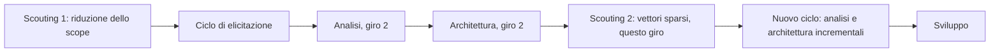

Il giro riapre un'esclusione del primo scouting: la ricerca ibrida con parole chiave era fuori scope per assenza di requisito. Il requisito ora esiste, quindi la decisione va rifatta.

## 3. Problem and outcome frame

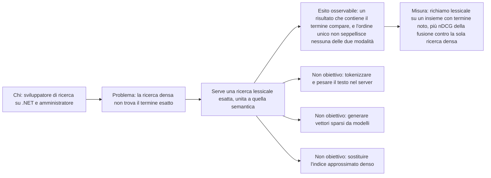

## 4. Capability and risk map

Caption: le capacità, il rischio dominante di ciascuna e la capacità che decide l'esito.

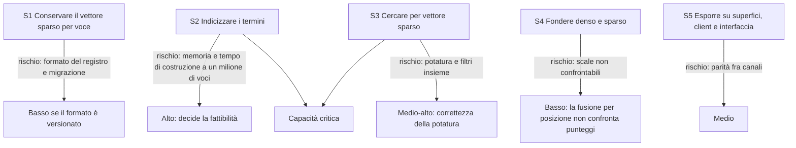

## 5. Adopt-extend-build map

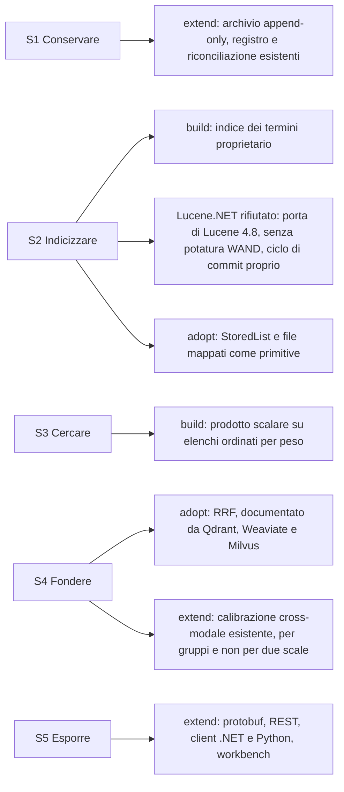

## 6. Competitor techniques

Caption: come i prodotti affermati rappresentano, inseriscono e cercano i vettori sparsi. Dettaglio e fonti in [Analogue solutions](dossier.md#analogue-solutions) (dossier.md#analogue-solutions).

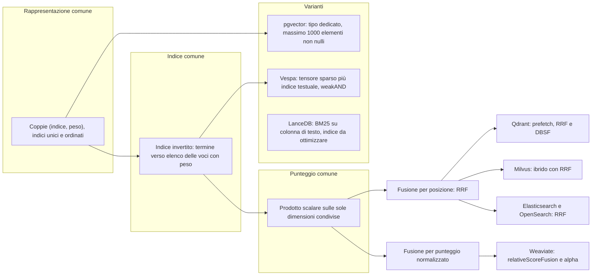

## 7. Who computes the weights

Caption: la linea di scope. Chi calcola i pesi decide se il server ha bisogno di un analizzatore e di statistiche di corpus.

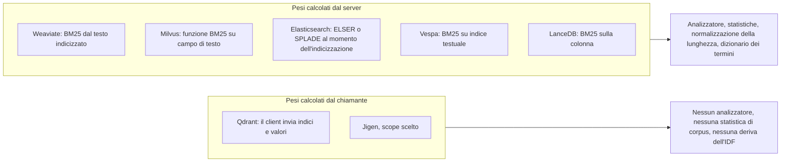

## 8. Question and proof map

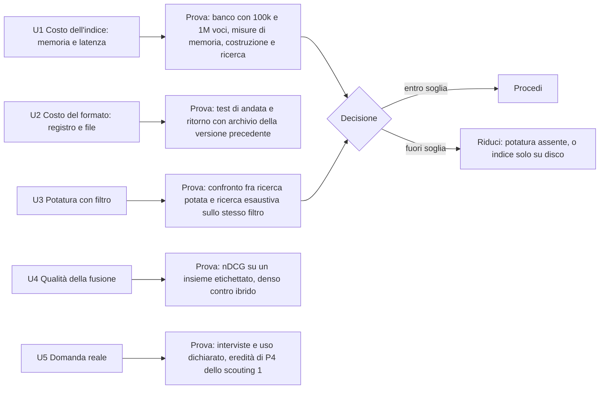

## 9. Data sources, actors and output types

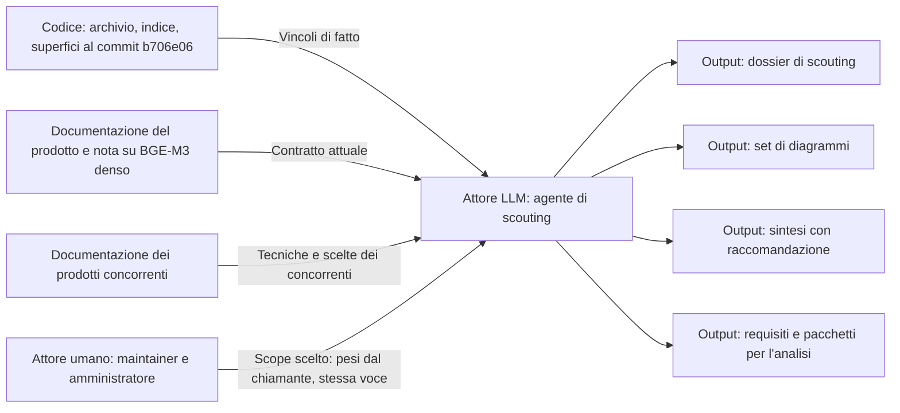

## 10. Management services per step

```mermaid
flowchart LR
  IN["Richiesta e codice"] -->|"Cosa manca"| F["Inquadrare il problema"]
  F -->|"Esito e non obiettivi"| A["Interrogare le assunzioni"]
  A -->|"Domande verificabili"| S["Cercare soluzioni adottabili"]
  S -->|"Adotta, estendi, costruisci"| AS["Leggere i concorrenti"]
  AS -->|"Tecniche e lezioni"| T["Valutare la fattibilità"]
  T -->|"Capacità e rischio"| U["Pianificare le prove"]
  U -->|"Prove minime"| O["Stimare l'ordine di grandezza"]
  O -->|"Intervallo"| D["Disegnare"]
  D -->|"Diagrammi"| H["Raccomandare"]
  H -->|"Verdetto"| OUT["Dossier, diagrammi, sintesi"]
  AS -->|"Nessuna fonte primaria"| GAP["Lacuna dichiarata"]
```

## 11. Service data flows grouped by deployment

Caption: dove si colloca l'indice dei termini rispetto alle unità già decise. Nessuna nuova unità distribuibile.

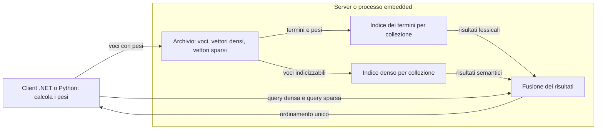

## 12. Gaps

| Lacuna | Effetto | Dove si chiude |
| --- | --- | --- |
| Nessuna misura di memoria e latenza dell'indice dei termini | La stima resta un intervallo ampio | U1 |
| Nessun insieme etichettato per misurare la fusione | La qualità della fusione non è verificabile oggi | U4 |
| Per Milvus e Vespa la fonte è la documentazione citata, non una prova eseguita | Le due schede descrivono il prodotto, non un confronto misurato | U6 |
| Il contratto di embedding dichiara BGE-M3 denso soltanto | I pesi lessicali vanno prodotti dal chiamante con un altro strumento | Scope scelto, nessuna modifica al server |
