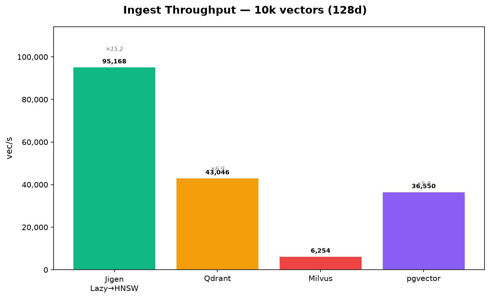
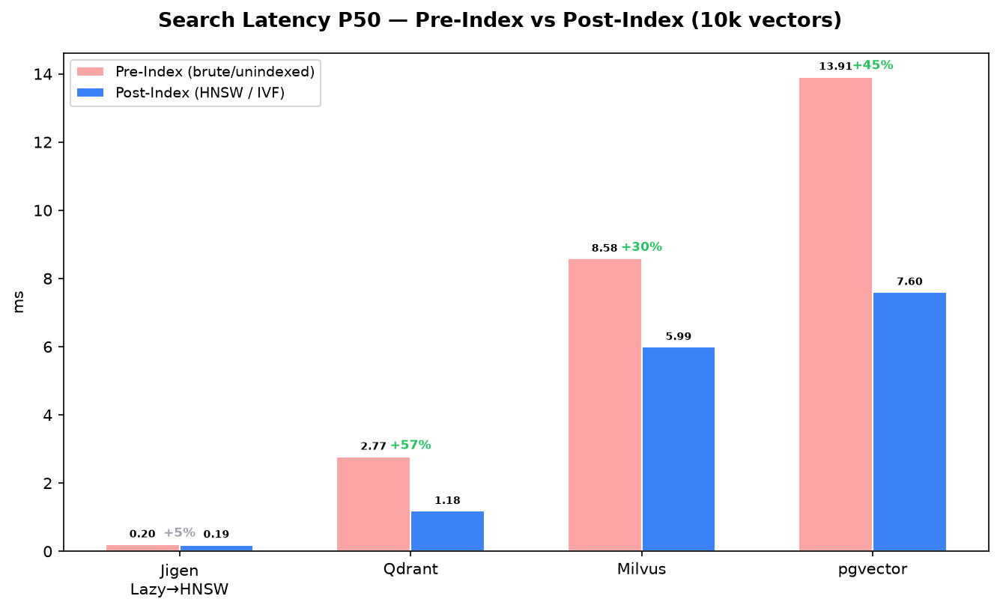
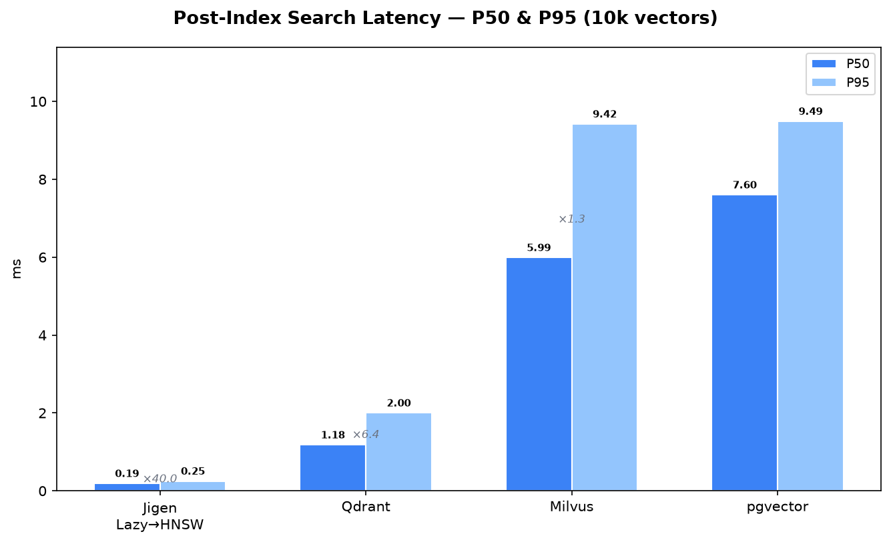
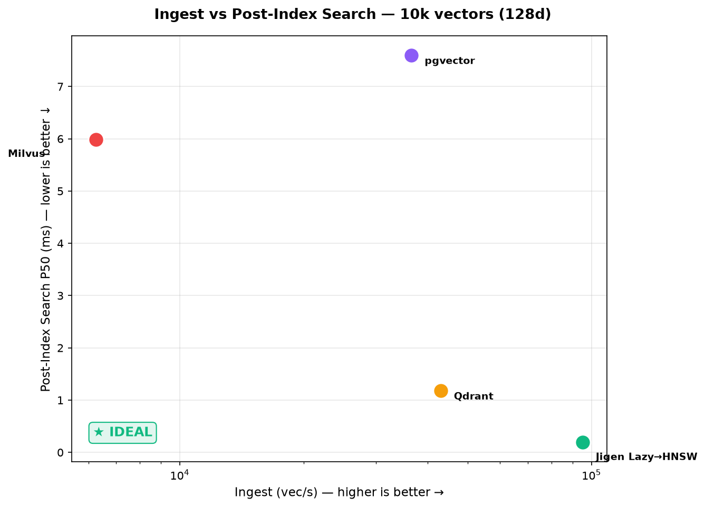
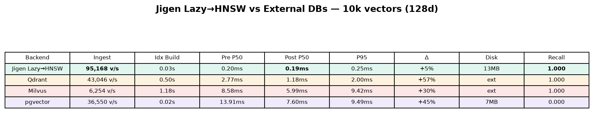

# Benchmarks & Hardware Support

Indicative performance numbers for the current release, plus the state of CPU/GPU acceleration. All figures were measured on a single consumer machine (22-core laptop CPU, NVMe storage, Linux); treat them as orders of magnitude, not guarantees, and re-run the benchmark on your own hardware and data.

## Running the benchmark

The repository ships a macro-benchmark covering ingest, search (with recall against exact brute force), delete, reopen, memory and disk usage:

```bash
cd tests/JigenBenchmarks
dotnet run -c Release -- 10000 128        # N vectors, dimensions
dotnet run -c Release -- 100000 128 sq8   # with SQ8 graph quantization
dotnet run -c Release -- 10000 128 w8     # with 8 indexing workers
dotnet run -c Release -- 10000 128 mv:8   # 8 vectors per document (multi-vector)
```

Vectors are random unit vectors — a worst case for HNSW recall. Real embedding datasets (which are clustered) typically achieve higher recall at the same settings.

### Multi-vector entries

`mv:K` stores `K` vectors per document (e.g. one embedding per passage) and reports both the ingest rate in documents and the number of vectors stored per second.

Measured on 10,000 documents × 128 dimensions, `M=16`, `efC=200`, `efS=80`, no quantization, WAL off, auto workers:

| Vectors/entry | Vectors file | Graph on disk | Ingest | HNSW search | Exact search | recall@10 | recall@10 on a non-first vector |
|---|---|---|---|---|---|---|---|
| 1 | 5.11 MB | 7.09 MB | 1904–2059 docs/s | 559–602 µs | 2722 µs | 0.993 | — |
| 4 | 19.76 MB | 28.35 MB | 366–388 docs/s | 866–1204 µs | 2053 µs | 0.895–0.900 | 0.926–0.932 |
| 8 | 39.29 MB | 56.70 MB | 171 docs/s | 944 µs | 2933 µs | 0.815 | 0.831 |

Reading of the numbers:

- **Vectors file is exact**: `documents × K × dimensions × 4 B` plus 24 B of record header per document, at every `K`.
- **The graph gets one node per vector**, so its size and its construction cost scale with `K`: graph bytes grow ~4× at `K=4` and ~8× at `K=8`, and ingest throughput (dominated by graph construction) drops by roughly the same factor. Store-only work still scales linearly with the bytes written.
- **Recall holds for every vector**: a document found through a non-first vector is ranked as well as through its first one (0.935 vs 0.902 at `K=4`), because nodes sharing a document key are merged by best score.
- **Query latency is nearly flat** (745 → 951 µs): each document occupies a single result slot, so extra nodes cost traversal, not result slots.
- **Exact search pays linearly in `K`**, as expected from scanning `K` vectors per candidate document.

Single-vector collections are unaffected: `mv:1` reproduces the same figures as a plain run.

All figures above were re-measured after removing the single-vector field from `VectorEntry` and the first-vector readers: ingest, query latency, recall and on-disk sizes match the pre-refactor run within noise, so the embeddings-only model costs nothing at runtime. Ingest acceptance for the lazy row is a file-write-only figure and varies with machine state; treat it as an order of magnitude.

### Lazy indexing

`lazy` wraps the indexer in `LazyIndexer(factory, threshold)` (threshold `lt:N`, default 9999): during ingest the graph is not touched at all, and a single reconciliation pass builds it when the threshold is crossed. The benchmark reports that pass as `index build`.

Measured on 10,000 documents × 128 dimensions, `M=16`, `efC=200`, `efS=80`, no quantization, WAL off, auto workers:

| Indexing | Vectors/entry | Ingest | Index build | Time to searchable | Search P50 | recall@10 |
|---|---|---|---|---|---|---|
| eager | 1 | 1904–2059 docs/s | — | 5 s | 559–602 µs | 0.993 |
| lazy | 1 | 104,644 docs/s | 14.54 s | 14.6 s | 547 µs | 0.996 |
| eager | 4 | 366–388 docs/s | — | 26 s | 866–1204 µs | 0.895–0.900 |
| lazy | 4 | 91,237 docs/s | 102.22 s | 102 s | ~900 µs | 0.903 |

Reading of the numbers:

- **Lazy defers, it does not accelerate.** Ingest acceptance becomes 47× faster because only bytes are appended, but the deferred reconciliation pass is **serial** (one `AddToIndex` per vector, no parallel wiring), so the total time to a searchable graph is 2–4× worse than eager indexing, which builds the graph concurrently with the writes across all `IndexerWorkers`.
- **Recall is identical**, including through a non-first vector at `K=4` (0.932), because the reconciliation pass now re-indexes every stored vector.
- **The threshold counts documents, not vectors**: `LazyIndexer` compares the collection's position-index size, so a `K`-vector document advances the counter by one.
- Lazy indexing pays off when accepting writes fast matters more than reaching a searchable graph fast, or when the collection stays under the threshold and never builds a graph at all.
- The comparative suite's lazy row does not reflect this: its pre-index phase issues 5 searches, the first of which triggers the switch, so the build cost lands in the pre-index sample and the `Index (s)` column shows only the cheap second pass.

## Comparative benchmarks (Jigen vs Qdrant vs Milvus vs pgvector)

A separate comparative benchmark suite (`tests/ComparativeBenchmarks`) measures Jigen against popular external vector databases: **Qdrant**, **Milvus**, and **pgvector**. All backends run on the same machine (22-core CPU, NVMe, Linux) with Docker/Podman containers for external services.

> **⚡ Important architectural difference**: in this benchmark, **Jigen runs in-process** — the adapter (`JigenAdapter`) creates a `Store` and `SmallWorldIndexer` directly in the benchmark process, with vectors in memory-mapped files and zero network overhead. **Qdrant, Milvus, and pgvector run as external services** in containers, accessed via gRPC (Qdrant, Milvus) or PostgreSQL wire protocol (pgvector) over `localhost`. Every search and ingest operation for external backends incurs serialisation, network stack traversal, and container boundary costs. This means the comparison is **embedded library vs client-server database** — choose the architecture that fits your deployment, not just the raw numbers.

### Methodology: pre-index vs post-index

Each backend goes through the same lifecycle to isolate indexing cost from search performance:

1. **Ingest** — all vectors are written to the database
2. **Flush** — data is persisted and made searchable
3. **Pre-index search** — 5 warmup queries measured before index construction (captures brute-force / unindexed performance)
4. **Build index** — the index is built (or rebuilt) and the backend waits for completion
5. **Post-index search** — 500 queries measured with the index active
6. **Delete + stats** — cleanup and disk/memory measurement

The `IVectorDbAdapter` interface was extended with a `BuildIndexAsync()` method to force and await index construction uniformly across all backends:

| Backend | Index type | BuildIndexAsync behaviour |
|---|---|---|
| **Jigen Lazy→HNSW** | HNSW (deferred) | `ReconcileAsync` — triggers the lazy switch from brute-force to HNSW when the threshold is crossed |
| **Qdrant** | HNSW (incremental) | Waits for `indexed_vectors_count ≥ points_count` with `full_scan_threshold=0` |
| **Milvus** | IVF_FLAT (nlist=128) | Release → drop minimal index → create IVF_FLAT → poll `DescribeIndexAsync` → reload |
| **pgvector** | IVFFlat (cosine) | `CREATE INDEX … USING ivfflat` with `lists = max(1, rows/1000)` |

### Jigen's lazy indexing strategy

Jigen uses a `LazyIndexer` wrapper that defers HNSW graph construction:

- **Below threshold**: `AddToIndex` is a no-op — vectors are written to the store files with **no graph building**, maximising ingest throughput. Searches use brute-force scanning.
- **Above threshold**: on the first search after crossing the threshold, the HNSW graph is built from the store in a single reconciliation pass. After the switch, all searches use the HNSW index.

This gives the best of both worlds: **fast bulk ingestion** (file writes only) followed by **fast vector search** (HNSW). The threshold is configurable via `JigenAdapter(lazyThreshold: …)` and defaults to 100000 vectors. (9999 used for 10k benchmark).


### Results — 10k vectors, 128 dimensions









**Jigen Lazy→HNSW achieves 0.19 ms P50 search latency** — **6× faster than Qdrant** (1.18 ms), **31× faster than Milvus** (5.99 ms), and **40× faster than pgvector** (7.60 ms).

At the same time, ingest throughput is **95,168 vec/s** — **2.2× Qdrant**, **15.2× Milvus**, and **2.6× pgvector**. This is possible because the lazy strategy writes vectors to files without building the graph until the first search.

> **Why is Jigen so much faster?** Two compounding effects: (1) the lazy indexing strategy skips graph construction during ingest, and (2) Jigen runs **in-process with no network hop** — every query is a direct C# call to memory-mapped data, while external backends pay gRPC/PostgreSQL protocol serialisation and container network overhead on every operation.



### Running the comparative benchmarks

```bash
# Start external services (requires Docker or Podman)
podman compose up -d qdrant milvus pgvector

# Generate datasets
cd tests/ComparativeBenchmarks
dotnet run -c Release -- generate

# Run macro-benchmark (ingest, pre/post-index search, delete, stats)
dotnet run -c Release -- macro jigendb-lazy-w4,qdrant,milvus,pgvector random-10k
dotnet run -c Release -- macro ALL random-100k

# Run micro-benchmark (BenchmarkDotNet, search-only)
dotnet run -c Release -- micro ALL random-100k
```

### Key takeaways

| Insight | Detail |
|---|---|
| **Lazy indexing changes when you pay, not how much** | Ingest acceptance is 32–47× faster than eager HNSW with identical search latency and recall, but the deferred reconciliation pass is serial: total time to a searchable graph is 2–4× worse. See [Lazy indexing](#lazy-indexing). |
| **In-process vs client-server** | Jigen runs **embedded in the process** (zero network, zero serialisation). Qdrant/Milvus/pgvector are **external services** accessed over gRPC/PostgreSQL — this architectural difference, not just algorithmic, drives the 6–40× latency gap. For client-server Jigen, see the [Server docs](server/overview.md). |
| **Index build cost varies** | Jigen eager: 0.03s (incremental, paid during ingest), pgvector: 0.02s (CREATE INDEX), Qdrant: 0.50s (background merge), Milvus: 1.18s (release→drop→create→wait→reload). The lazy Jigen row reports only a second no-op pass: the real build runs inside the pre-index warmup and takes ~20s per 10k vectors. |
| **Recall parity** | All indexed backends achieve Recall@10 = 1.000 on this dataset |

## Vector index (HNSW, disk-backed)

Settings: `M=16`, `EfConstruction=200`, `EfSearch=80`, dim 128, top-10, concurrent indexing enabled.

| Dataset | Ingest | Search | Recall@10 | Delete | Reopen + first query | Graph on disk |
|---|---|---|---|---|---|---|
| 10k × 128 (float) | ~2,700 vec/s | ~0.5 ms/query | ~0.99 | ~23 µs | ~44 ms | 7.1 MB |
| 10k × 128 (SQ8) | ~2,700 vec/s | ~0.6 ms/query | ~0.99 | ~23 µs | — | **3.4 MB** |
| 100k × 128 (float) | ~1,340 vec/s | ~2.4 ms/query | 0.80 at efS=80¹ | ~23 µs | ~0.5 s | ~70 MB |

¹ Uniform random vectors at 100k scale need a higher `EfSearch` for high recall; see [HNSW tuning](indexes/hnsw.md).

Additional characteristics:

- **Memory**: the graph is memory-mapped; managed heap at 100k vectors is ~130 MB (vectors stay on mmap, not on the heap).
- **Brute force** (exact) is roughly 1.7 ms/query at 5k × 128 and scales linearly with collection size — see [Brute-force index](indexes/brute-force.md) for when that is the right choice.
- **SQ8 quantization** cuts graph vector storage 4× with negligible recall loss when `ExactRerank` is enabled (default).

## Sparse and hybrid search

Sparse search answers from the per-collection inverted index described in
[Sparse index](indexes/sparse.md); the hybrid search runs both halves and fuses
them by reciprocal rank. All figures below are from the same machine as the rest
of this page, in Release, best of 3 rounds over 200 queries.

The sparse figures come from a dedicated harness driving `Jigen.Index.Sparse`
and `Jigen.Store` directly (the parameters are in each table, so the
measurements can be reproduced against those APIs); they are not yet part of the
macro-benchmark in `tests/JigenBenchmarks`.

### Engine, reference corpus (worst case for term frequency)

3,000 documents, 1–3 vectors per document, 60 terms per vector drawn from a
**200-term** vocabulary, 20-term queries. Every term therefore appears in about
60% of the documents — a pathological corpus that makes each query scan a large
part of the index.

| Metric | Value |
|---|---|
| Corpus | 362,220 postings, 5,751 blocks × 64 |
| Build / open | 447 ms / ~0 ms |
| Index on disk | 5.97 MB |
| Search k=1 / k=10 / k=100 / all | 8.3 / 8.6 / 9.0 / 11.4 ms per query |
| Allocation at k=10 | 1,052 KiB per query |
| k=all with `minimumScore` keeping ~30 documents | 9.2 ms |

### Engine, realistic vocabulary

30,000 documents, 2 vectors each, 60 terms per vector drawn from a
**50,000-term** vocabulary, so a term matches about 70 documents.

| Metric | Value |
|---|---|
| Corpus | 3.6 M postings, 90,458 blocks × 64 |
| Build | 1.70 s |
| Index on disk | 63.55 MB — **18.5 B per posting** |
| Search k=1 / k=10 / k=100 / all | 0.84 / **0.89** / 1.03 / 1.41 ms per query |
| Allocation at k=10 | 68 KiB per query |

The two tables together are the point: with the same engine and a corpus 10×
larger, the realistic vocabulary is ~10× faster. Sparse cost follows
**query terms × posting-list length**, not collection size.

### Store, dense + sparse + hybrid

10,000 documents, 2 vectors of 128 dimensions and 120 sparse terms each, HNSW
`M=16`, `efC=200`, `efS=80`, WAL off, batches of 1,000.

| Metric | Value |
|---|---|
| Ingest acceptance (queue) | 36 ms — 277,000 docs/s |
| Durable ingest (write + index) | 13.3 s — **751 docs/s** |
| Sparse k=10, 2 segments | 6.5 ms |
| Sparse k=10, after `Shrink` (1 segment) | **3.7 ms** |
| Sparse k=10, after reopen | 3.5 ms |
| Dense k=10 | 0.63 ms |
| Hybrid k=10 | 8.1 ms → 4.6 ms after reopen |
| `Shrink` / reopen | 490 ms / 60 ms |

Query shape on a 30,000-document collection (3.6 M postings, 200-term
vocabulary), k=10:

| Query terms | Sparse search |
|---|---|
| 5 | 9.9 ms |
| 20 | 82 ms |
| 60 | 336 ms |

### Transport (gRPC)

2,000 documents with 1 vector of 128 dimensions and 60 sparse terms, fresh
database, local server on the same machine:

| Operation | Value |
|---|---|
| `SetVector`, one call per document | 313 docs/s (1.5–3.2 ms per call across runs) |
| `SetVectors`, client streaming | 79 ms — **25,000 docs/s** |
| `SearchSparse` k=10 | 8.3 ms per query, round trip included |
| Unary reference call (`Count`) | 1.7 ms per call |

### Reading the numbers

- **Compaction is on the read path.** The same query costs 6.5 ms with two live
  segments and 3.7 ms with one: the search asks every segment and merges. A
  delete-heavy workload, and a repeated `Clear`, degrade sparse latency until a
  `Shrink` compacts the collection (observed: 8.3 → 16.8 → 24.2 ms per query
  over three clear-and-reload cycles with no compaction in between).
- **Hybrid ≈ dense + sparse.** 8.1 ms against 0.63 ms dense and 6.5 ms sparse on
  the same collection: the fusion itself is noise.
- **`minimumScore` pays.** At k=all it drops the query from 11.4 to 9.2 ms by
  pruning whole blocks, on top of filtering the results.
- **Batch the ingestion.** Over gRPC, streaming 2,000 entries in one call is
  ~80× faster than one call per document; in-process, the batch is what closes a
  sparse segment.
- **Sparse ingest is cheap, HNSW is not.** The 751 docs/s of durable ingest above
  is dominated by graph construction (2 vectors per document, single indexer);
  the sparse index writes at ~0.47 µs per posting (1.70 s for 3.6 M postings).

## Embedding generation (CPU)

Model `nomic-embed-text-v1.5`, ~250-token texts, concurrency 2, 22-core CPU:

| Configuration | Latency per embedding |
|---|---|
| fp32 model, default threading | ~215 ms (unstable, 110–220 ms) |
| **int8 model + tuned intra-op threads** | **~80 ms (stable)** |

Recommendations that follow from these measurements (all defaults in the current release):

- Use the **int8** model variant on CPU (~2.4–2.7× faster; retrieval ranking identical to fp32 in our tests).
- Leave `MaxBatchSize = 1` on CPU: intra-op parallelism already saturates the cores, and padding on mixed-length batches makes batching a net loss. Batching pays off on GPUs.
- Leave `IntraOpNumThreads = 0` (auto = cores / concurrency) unless you have measured otherwise.

## CPU/GPU technologies

Embedding inference runs on ONNX Runtime execution providers, selected at build/publish time with the `JigenOnnxRuntimeFlavor` MSBuild property and at runtime with `ExecutionProvider`. Full details in [Execution providers](embeddings/execution-providers.md).

| Technology | Status |
|---|---|
| CPU (x64/arm64, all platforms) | **Supported, default.** SIMD-accelerated distance math (`TensorPrimitives`), int8 ONNX models |
| Apple CoreML (Apple Silicon ANE/GPU) | **Supported**, included in the default package; automatic CPU fallback |
| NVIDIA CUDA | **Implemented** (`-p:JigenOnnxRuntimeFlavor=Gpu` + `"ExecutionProvider": "cuda"`); validation on target hardware in progress |
| DirectML (Windows, any GPU) | **Implemented** (`DirectML` flavor); note Microsoft is transitioning DirectML towards WinML |
| Intel OpenVINO (GPU/NPU) | **Implemented** (`OpenVino` flavor); Windows x64 only via NuGet |
| AMD ROCm / MIGraphX | **In development** — supported by the code, but requires a custom ONNX Runtime native build (no NuGet package exists) |
| Vulkan | Not available in ONNX Runtime; not planned |

On the index side, SQ8 scalar quantization is available today; additional index types (e.g. a KMeans/IVF-style indexer) are under development.

Whenever a GPU execution provider fails to initialize (missing driver, wrong package), Jigen logs a warning and **falls back to CPU automatically** — the service keeps working.
