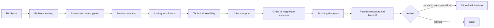
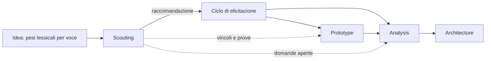
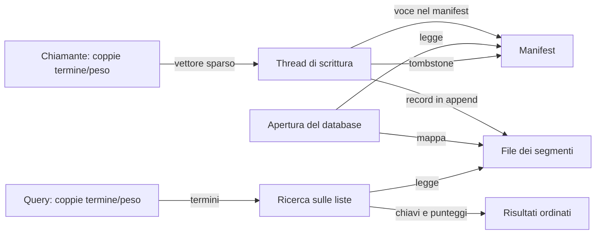
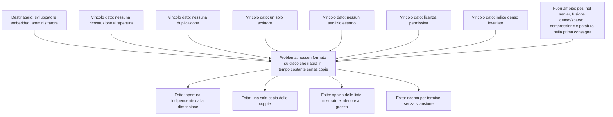
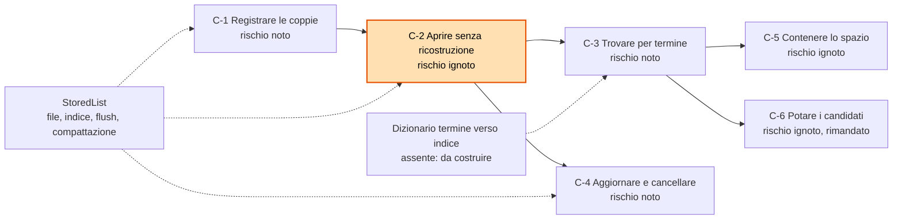
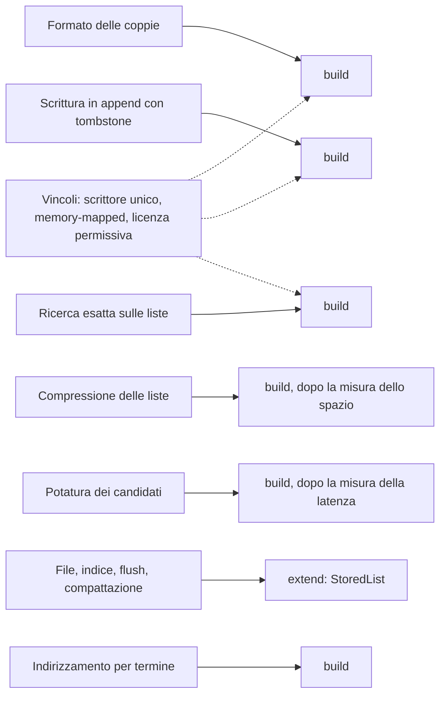
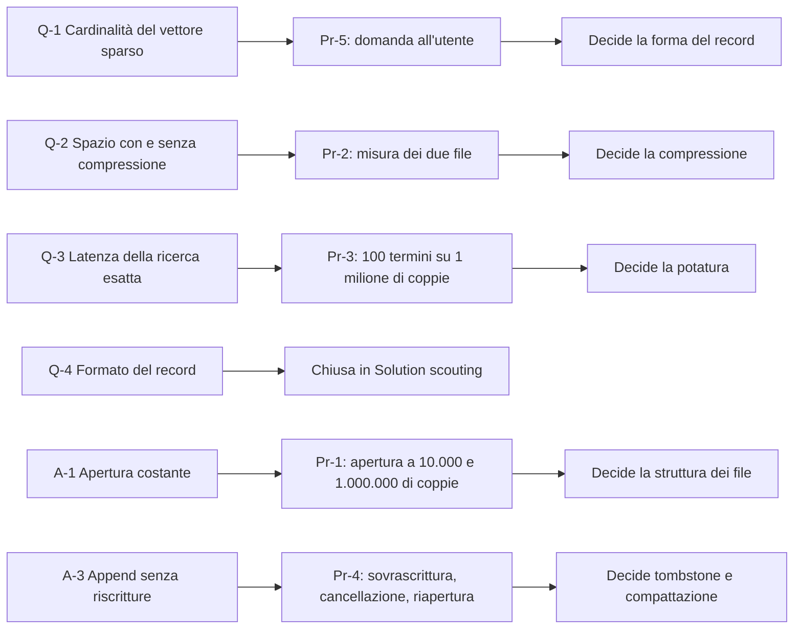

# Scouting diagrams

Set di diagrammi del giro di scouting sulla struttura su disco dei vettori sparsi. Ogni diagramma è richiamato dalla sezione del dossier che lo possiede.

## 1. Phase flow

## 2. Position in the lifecycle

## 3. Data sources, actors and output types

## 4. Management services per step

```mermaid
flowchart LR
  A1["Accettare le coppie"] -- "coppie validate" --> A2["Scrivere il segmento"]
  A2 -- "segmento immutabile" --> A3["Aggiornare il manifest"]
  A3 -- "numero di segmenti" --> A4["Aprire il database"]
  A4 -- "segmenti mappati" --> A5["Cercare per termine"]
  A5 -- "candidati" --> A6["Ordinare e troncare"]
  A6 -- "top-k" --> A7["Restituire"]
  A2 -- "voce sovrascritta" --> T["Tombstone nel manifest"]
  T -- "spazio morto" --> C["Compattazione periodica"]
  C -- "nuovo segmento" --> A3
```

## 5. Problem and outcome frame

## 6. Capability and risk map

## 7. Adopt-extend-build map

## 8. Question and proof map

